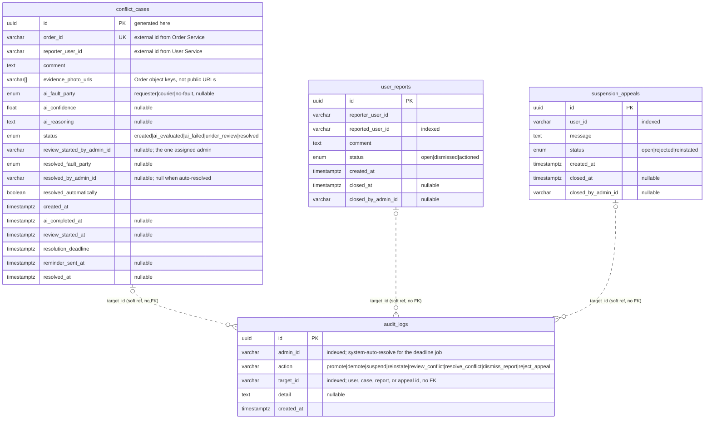
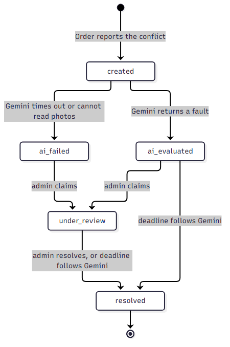

# Admin Service — Database Schema

**Datastore:** PostgreSQL · **Model:** one conflict case per order, one open user report per pair, one open suspension appeal per user, plus an append-only audit log

The Admin Service stores delivery-conflict cases, user reports, suspension appeals, and the audit trail of privileged
actions for Friend on Campus (FoC). User records stay in User Service. This
document describes the persistence model backing user administration (F1),
conflict intake, AI evaluation, claim, and resolution (F3), and the report and appeal queues.

The executable schema is the Alembic chain under `alembic/versions/`
(`b84b9a872e82` → `0002_conflict_stages` → `0003_audit_logs_append_only` → `0004_user_reports_and_appeals`).
SQLAlchemy models live in `app/models/`.

## Design decisions

- **PostgreSQL** — one transaction can update a case and insert its audit row
  together. Enums constrain status and fault party.
- **This service does not own users or orders.** `order_id`, `reporter_user_id`,
  and `admin_id` are external identifiers stored as `VARCHAR`. Order Service
  mints order ids as UUIDs; User Service mints user ids. This service never
  generates them, and there is no foreign key to those databases.
- **One case per order.** `conflict_cases.order_id` is unique so an Order
  Service retry cannot open a second case (F3.1).
- **One open report per pair, one open appeal per user.** Partial unique
  indexes on `user_reports` and `suspension_appeals` allow a new row only
  after the previous one is closed. A repeat intake returns the open row.
- **`audit_logs` is append-only** (NFR2.2). Inserts go through
  `app/services/audit.py` only (NFR2.1). Migration `0003_audit_logs_append_only`
  revokes `UPDATE`, `DELETE`, and `TRUNCATE` and adds triggers that reject
  those statements for every role, including the table owner.
- **`target_id` is a soft reference, not a foreign key.** A row may point at a
  user id (`promote`, `demote`, `suspend`, `reinstate`), a conflict case id
  (`review_conflict`, `resolve_conflict`), a report id (`dismiss_report`), or
  an appeal id (`reject_appeal`). The log must stay readable if the
  case row is ever removed, and it must be able to name a user that lives in
  another database.
- **Photos are names, not bytes.** `evidence_photo_urls` holds Order's object
  keys (`{orderId}/collection.jpg`, then delivery, then dispute when present).
  The bytes stay in Order's photo bucket. The AI job reads those keys with
  `GetObject`.
- **Idempotency is the unique order plus a conditional update.**
  - **Intake** is create-once. A repeat `POST` for the same `order_id` returns
    the existing row. A concurrent duplicate hits the unique index and is
    read back (`INSERT`, then on unique violation `SELECT`).
  - **Claim and resolve** are update-once. The `UPDATE ... WHERE status IN (...)`
    matches zero rows when another request already moved the case, so a second
    claim or a second resolve does not write again.
- **Timers are rows in `apscheduler_jobs`.** APScheduler creates that table on
  startup. It is not a domain table and is not in the Alembic chain. Resolving
  a case removes its reminder and deadline jobs.

## Entity–Relationship Diagram



**Reading the diagram**

- There are **no foreign keys**. The tables live in this database, but
  `audit_logs.target_id` is polymorphic and the user and order identifiers belong to
  User Service and Order Service.
- The **dashed line** is that soft link: a conflict audit row names one case,
  a dismiss names one report, a reject names one appeal, and a user-admin audit row names a user id.
- One order has at most one `conflict_cases` row. One case has one assigned
  admin (`review_started_by_admin_id`) once it is claimed. One reporter/reported
  pair has at most one open report. One user has at most one open appeal.

## Tables

### `conflict_cases` — one open dispute per order

Saved at intake (F3.1). AI fields are filled by the background job. One admin
claims the case; resolve records the outcome.

| Column | Type | Constraints | Notes |
|---|---|---|---|
| `id` | `UUID` | **PK** | Generated by this service. |
| `order_id` | `VARCHAR` | `NOT NULL`, **unique index** `ix_conflict_cases_order_id` | External id from Order Service. The unique index is the intake idempotency key. |
| `reporter_user_id` | `VARCHAR` | `NOT NULL` | Requester who escalated, or the order's requester on a missed deadline. |
| `comment` | `TEXT` | `NOT NULL` | Dispute text, or `Delivery deadline missed`. |
| `evidence_photo_urls` | `VARCHAR[]` | `NOT NULL` | Object keys in collection, delivery, dispute order. Empty when Order sent none. The name says URLs; the values are keys. |
| `ai_fault_party` | `faultparty` | `NULL` | Set when status becomes `ai_evaluated`. |
| `ai_confidence` | `FLOAT` | `NULL` | Model score in `0.0`–`1.0`. The range is checked in the app, not by a `CHECK`. |
| `ai_reasoning` | `TEXT` | `NULL` | Short model explanation. |
| `status` | `conflictstatus` | `NOT NULL` | See enum below. Application default `created`. |
| `review_started_at` | `TIMESTAMPTZ` | `NULL` | Set on the first successful claim. |
| `review_started_by_admin_id` | `VARCHAR` | `NULL` | The single assigned admin. A second admin cannot claim. |
| `resolved_fault_party` | `faultparty` | `NULL` | Manual choice, or a copy of `ai_fault_party` on auto-resolve. |
| `resolved_by_admin_id` | `VARCHAR` | `NULL` | Admin who called resolve. `NULL` when the deadline job resolves the case. |
| `resolved_automatically` | `BOOLEAN` | `NOT NULL` | Application default `false`. `true` for deadline auto-resolve (F3.5). |
| `created_at` | `TIMESTAMPTZ` | `NOT NULL` | Intake time. |
| `ai_completed_at` | `TIMESTAMPTZ` | `NULL` | When the AI job finished, including a failure. |
| `resolution_deadline` | `TIMESTAMPTZ` | `NOT NULL` | `created_at` plus `RESOLUTION_DEADLINE_HOURS` (default 168). |
| `reminder_sent_at` | `TIMESTAMPTZ` | `NULL` | Set by the reminder job. No notification is sent yet. |
| `resolved_at` | `TIMESTAMPTZ` | `NULL` | |

**`conflictstatus` enum** — `created`, `ai_evaluated`, `ai_failed`,
`under_review`, `resolved`.

```
created  →  ai_evaluated  →  under_review  →  resolved
         →  ai_failed     ↗
```

Source: [conflict-state-diagram.mmd](conflict-state-diagram.mmd). Rendered figure: [conflict-state-diagram.png](conflict-state-diagram.png).



Deadline auto-resolve can also go `ai_evaluated` → `resolved`, and
`under_review` → `resolved` when `AUTO_RESOLVE_WHILE_UNDER_REVIEW` is true.

**`faultparty` enum** — `requester`, `courier`, `no-fault`. The hyphen in
`no-fault` is the stored value.

### `audit_logs` — append-only record of privileged actions

One row per promote, demote, suspend, reinstate, claim, resolve, report dismiss, and appeal reject.

| Column | Type | Constraints | Notes |
|---|---|---|---|
| `id` | `UUID` | **PK** | |
| `admin_id` | `VARCHAR` | `NOT NULL`, index `ix_audit_logs_admin_id` | Calling admin, or `system-auto-resolve` for the deadline job. |
| `action` | `VARCHAR` | `NOT NULL` | `promote`, `demote`, `suspend`, `reinstate`, `review_conflict`, `resolve_conflict`, `dismiss_report`, `reject_appeal`. Not a database enum. |
| `target_id` | `VARCHAR` | `NOT NULL`, index `ix_audit_logs_target_id` | User id, conflict case id, report id, or appeal id. Not a foreign key. |
| `detail` | `TEXT` | `NULL` | Resolve rows store `decision=accept\|reject, fault_party=...` or `auto-resolved, fault_party=...`. |
| `created_at` | `TIMESTAMPTZ` | `NOT NULL` | |

Triggers `audit_logs_no_update`, `audit_logs_no_delete`, and
`audit_logs_no_truncate` call `forbid_audit_log_mutation()` and raise
`audit_logs is append-only`.

### `user_reports` — a user reporting another user

Saved when User Service calls intake. The reported account stays unchanged
until an admin suspends them through the existing user route, or dismisses
the report.

| Column | Type | Constraints | Notes |
|---|---|---|---|
| `id` | `UUID` | **PK** | Generated by this service. |
| `reporter_user_id` | `VARCHAR` | `NOT NULL` | External id from User Service. |
| `reported_user_id` | `VARCHAR` | `NOT NULL`, index `ix_user_reports_reported_user_id` | The user an admin may suspend. |
| `comment` | `TEXT` | `NOT NULL` | The reporter's text. A retry does not replace it. |
| `status` | `reportstatus` | `NOT NULL` | `open`, `dismissed`, `actioned`. |
| `created_at` | `TIMESTAMPTZ` | `NOT NULL` | |
| `closed_at` | `TIMESTAMPTZ` | `NULL` | Set on dismiss or when suspend actions the row. |
| `closed_by_admin_id` | `VARCHAR` | `NULL` | Admin who dismissed it, or who suspended the reported user. |

**Partial unique index** `uq_user_reports_open_pair` on
(`reporter_user_id`, `reported_user_id`) `WHERE status = 'open'`.

```
open  →  dismissed   (dismiss, no suspension)
      →  actioned    (suspend of reported_user_id)
```

### `suspension_appeals` — a suspended user asking to come back

Saved when User Service calls intake after it has checked the password.
The account stays suspended until an admin reinstates them, or rejects
the appeal.

| Column | Type | Constraints | Notes |
|---|---|---|---|
| `id` | `UUID` | **PK** | Generated by this service. |
| `user_id` | `VARCHAR` | `NOT NULL`, index `ix_suspension_appeals_user_id` | The suspended user. |
| `message` | `TEXT` | `NOT NULL` | The appeal text. A retry does not replace it. |
| `status` | `appealstatus` | `NOT NULL` | `open`, `rejected`, `reinstated`. |
| `created_at` | `TIMESTAMPTZ` | `NOT NULL` | |
| `closed_at` | `TIMESTAMPTZ` | `NULL` | Set on reject or when reinstate closes the row. |
| `closed_by_admin_id` | `VARCHAR` | `NULL` | Admin who rejected it, or who reinstated the user. |

**Partial unique index** `uq_suspension_appeals_open_user` on (`user_id`)
`WHERE status = 'open'`.

```
open  →  rejected     (reject, suspension stays)
      →  reinstated   (reinstate of user_id)
```

## Transaction boundaries

Kafka is published **after** the database commit. A broker failure is logged
and does not roll back the row. There is no outbox.

| Flow | Requirement | The transaction does |
|---|---|---|
| Intake | F3.1 | `INSERT conflict_cases`. On unique `order_id` violation, roll back and return the existing row. Jobs and `ConflictCaseCreated` run after commit. |
| AI evaluation | F3.2 | No transaction held across the S3 read or the Gemini call. Then `UPDATE conflict_cases SET status = ai_evaluated\|ai_failed WHERE status = created`. |
| Reminder | F3.7.1 | `UPDATE reminder_sent_at` if the case is not `resolved`. |
| Claim | F3.4 | `UPDATE ... SET status = under_review WHERE status IN (ai_evaluated, ai_failed)` plus `INSERT audit_logs (review_conflict)`. Same admin repeating the claim does not insert a second audit row. `admin.review.started` is after commit. |
| Manual resolve | F3.4.2 | `UPDATE ... SET status = resolved WHERE status = under_review` plus `INSERT audit_logs (resolve_conflict)`. Any admin may resolve; the claim check is not repeated. `admin.case.resolved` is after commit. |
| Auto-resolve | F3.5 | Same resolve update, allowed from `ai_evaluated` (and `under_review` when configured), only when `ai_fault_party` is set and `ai_confidence` meets the floor. `resolved_by_admin_id` stays null. |
| Promote / demote / suspend / reinstate | F1 | User Service is called **before** this transaction. Then `INSERT audit_logs` and commit. Suspend also sets every open `user_reports` row for that user to `actioned`. Reinstate sets that user's open `suspension_appeals` row to `reinstated`. The matching user event is after commit. A User Service failure writes nothing here. |
| Report intake | — | `INSERT user_reports`. On the partial unique index, roll back and return the open row. No audit row and no user-status change. |
| Dismiss report | — | `UPDATE user_reports SET status = dismissed WHERE status = open` plus `INSERT audit_logs (dismiss_report)`. |
| Appeal intake | — | `INSERT suspension_appeals`. On the partial unique index, roll back and return the open row. No audit row and no user-status change. |
| Reject appeal | — | `UPDATE suspension_appeals SET status = rejected WHERE status = open` plus `INSERT audit_logs (reject_appeal)`. |
