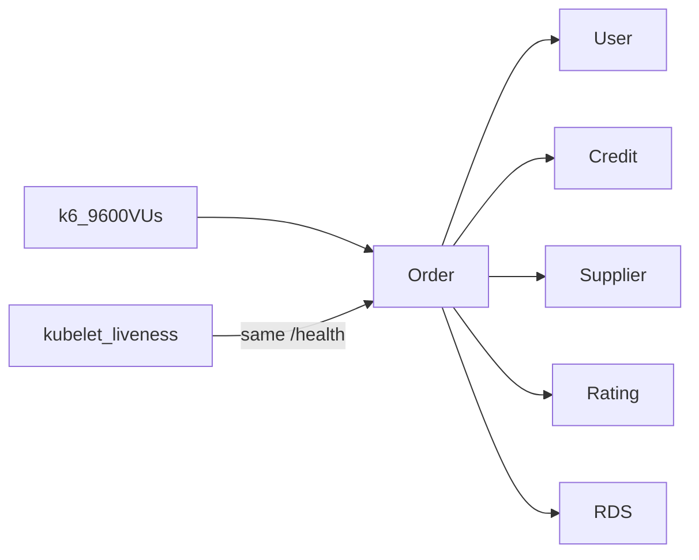

# Fix Order full-load collapse

## What broke

Second full run (proxy already at 512Mi): Linkerd stayed up; **Order** stopped answering `/health` within 1s (502/504/timeout) → kubelet SIGTERM (exit 143) → restart storm → ~80% create/read failures. Successful requests averaged ~8.7s. Downstream HPAs barely moved (credit/supplier at 1).

Root issues to fix (in order):

1. **Liveness uses the same DB-backed `/health`** — under load that is exactly when you must *not* kill the process.
2. **Proxy 512Mi is only a live kubectl patch** — Argo can wipe it.
3. **Capacity** — Order at max 16 still saturated; create path deps under-scaled.

## Fix 1 — Liveness must not depend on DB / request threads (highest leverage)

Today [`deploy/charts/foc-service/templates/deployment.yaml`](deploy/charts/foc-service/templates/deployment.yaml) uses one `healthPath` for both readiness and liveness (default timeout 1s). Order’s [`application-k8s.yml`](order-service/src/main/resources/application-k8s.yml) maps `/health` to Actuator with `include: "*"`.

**Do this:**

- In Order `application-k8s.yml`, add Actuator groups:
  - **liveness** → ping only, expose at `/live` (or `/actuator/health/liveness`)
  - **readiness** → keep DB (current `/health` behavior)
- In `foc-service` chart: support separate `livenessPath` / `readinessPath` (fallback: both = `healthPath` for other services). Set Order values to `livenessPath: /live`, `readinessPath: /health`.
- On probes: set `timeoutSeconds: 5`, raise liveness `failureThreshold` (e.g. 5) so brief stalls don’t immediately kill.

This alone stops the “overloaded → kill → worse overload” loop.

## Fix 2 — Durable Linkerd proxy memory on Order

Extend [`deployment.yaml`](deploy/charts/foc-service/templates/deployment.yaml) mesh annotations with optional:

- `config.linkerd.io/proxy-memory-request`
- `config.linkerd.io/proxy-memory-limit`

Wire from `mesh.proxy.memoryRequest` / `mesh.proxy.memoryLimit` in chart values. In [`deploy/values/envs/dev/services/order.yaml`](deploy/values/envs/dev/services/order.yaml) set **256Mi / 512Mi** (what already worked).

## Fix 3 — Capacity for the 9600 VU target (dev Order + create path)

In [`deploy/values/envs/dev/services/order.yaml`](deploy/values/envs/dev/services/order.yaml):

- Raise Order resources (e.g. request **1 CPU / 1Gi**, limit **2 CPU / 2Gi** — keep `MaxRAMPercentage=60`).
- Raise `autoscaling.maxReplicas` (e.g. **24**), still with RDS xlarge during full runs.

In create-path deps (dev values): raise **minReplicas** for the load window or at least **maxReplicas** + ensure CPU requests so HPA can fire — User / Credit / Supplier stayed at 1–3 while Order was at 16. Concrete: User max **12**, Credit max **8**, Supplier max **8**, and set minReplicas to **2** for those three in dev so create isn’t single-pod cold.

(Do **not** change the k6 scenario or thresholds as the “fix”; the product path must absorb the load.)

## Verify

1. Merge → Argo syncs `dev-order` (and user/credit/supplier). Confirm annotations show 512Mi proxy; probes hit `/live` + `/health`.
2. Seed → smoke (must still pass).
3. RDS `db.m7g.xlarge` → full run → expect thresholds under 5% and **no** Order liveness kill storm (`kubectl get pods` restarts stay flat).
4. Scale RDS back after.

## Out of scope for this fix

- Tuning Tomcat/Hikari pools in Java (only if a third full run still saturates after the above).
- Changing load-test VU count as a substitute for capacity.
