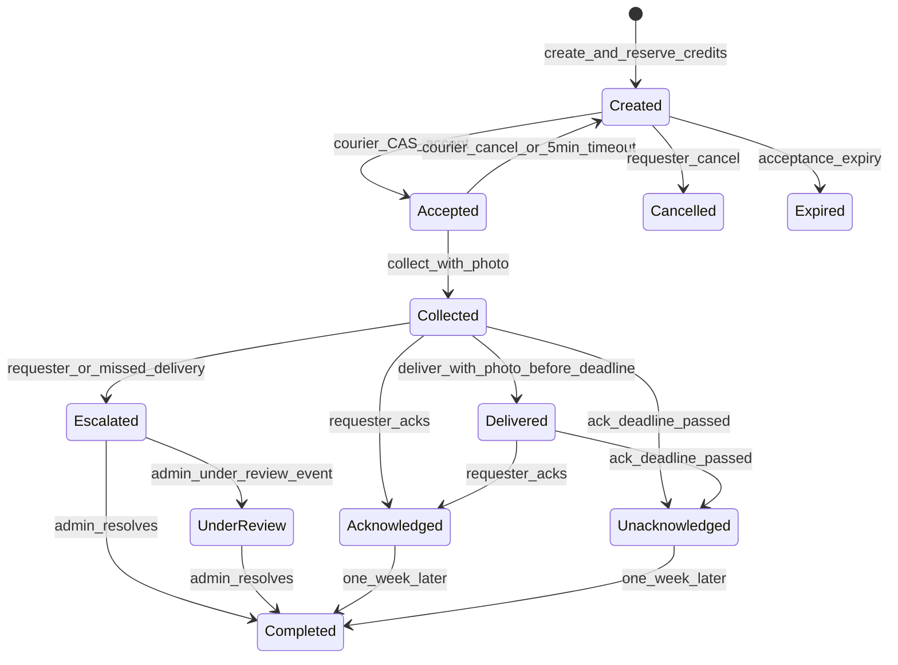

# Order Service — requirements and implementation plan

Scope is only [`order-service/`](order-service/), backend only. Do not implement user, credit, supplier, rating, admin, or UI code. Those appear only as HTTP calls or Kafka messages this service sends or consumes. Root [`compose.yaml`](compose.yaml) stays untouched.

## Stack and containers

**Java 21, Spring Boot 3.5, Maven, Spring Kafka.** One deployable process: REST API, deadline sweeper, and outbox publisher run in the same JVM. A status change and its outbox row commit together in Postgres. The publisher then sends that row to Kafka and retries if the broker is down, so an async timeout never rolls the order back (NFR4.1.2). Deadlines stay in Postgres, so a restart still fires them.

**Plain PostgreSQL 16** for order data (no PostGIS). The orders table stores pickup and dropoff latitude/longitude. Proximity is not stored and is not computed when an order is created or when someone opens one order.

Ranking runs only when a courier asks for the open task list. The request carries that courier’s current coordinates. Postgres returns `Created` orders inside a bounding box around those coordinates (indexed lat/lng). Java then sorts that set by haversine distance to the pickup, then by reward, and slices the page. The next list request ranks again. Opening one order by id, and the requester’s “my orders” list, do not use proximity: my orders are newest first. If the courier sends no coordinates, the list is ordered by reward only.

With PostGIS the same list request would look different. Pickup would be a `geography(Point)` column with a GiST index, and the `ORDER BY` would sit in SQL (`pickup <-> courier_point`), so Postgres would return rows already nearest-first and the page `LIMIT`/`OFFSET` would be correct in the database. The app would only pass the courier’s lat/lng through. We are not doing that; the bounding-box-plus-Java-sort above is the stand-in for the backlog’s PostGIS line.

Two custom images, plus official Postgres images that have no Dockerfile of their own:

- [`order-service/Dockerfile`](order-service/Dockerfile) — multi-stage build (Maven compile, then a JRE image running the Spring Boot jar). This is the image that gets deployed. It does not contain Postgres, Kafka, SonarQube, or test tooling. At runtime it reads `SPRING_DATASOURCE_URL`, `SPRING_KAFKA_BOOTSTRAP_SERVERS`, and the other service base URLs from the environment. In deployment, Postgres and Kafka are external. Locally, `compose.yaml` runs this image next to official `postgres:16` and `apache/kafka` (KRaft, no ZooKeeper) containers. Kafka is not a third Dockerfile.
- [`order-service/Dockerfile.local`](order-service/Dockerfile.local) — SonarQube only, based on the SonarQube Community image. The app is not copied into it and it is not deployed. `compose.local.yaml` runs that image plus a second official `postgres:16` used only by SonarQube. Further local-only tools can be added to this compose file later without touching the deploy image.

`mvn verify sonar:sonar` runs on the host (or CI) against the local SonarQube URL. JaCoCo supplies the coverage figure NFR6 asks for (>90%).

## What this service owns

An errand request from creation through terminal status, including the open-task pool, courier ranking/search, proof photos, deadlines that survive restarts, and the messages other services consume.

UI pages (Home, New Request, Order Tracking, Escalation modal) are out of this folder. The API must still return the fields those pages need: item description, pickup/dropoff, credits, requester rating, time posted, acceptance expiry, status, both photos, and the three countdown deadlines (5-minute collection, delivery, acknowledgement).

## Functional requirements

**F1 — create an errand (High, 2 Oct; rating is Medium, 9 Oct).** Persist requester email, credit reward (minimum 1), acceptance expiry (strictly after now), delivery deadline (strictly after now and after expiry), From and To locations, and request time (not after now; set it on the server). Before insert: User Service must say the requester is valid; Supplier Service must accept both locations as real approved locations (supplier records are Name, Type, Building, Floor, description, lat/lng); Credit Service must confirm the reward is available. Requester rating is read from Rating Service (can land in the 9 Oct slice). Also store **item description** — the New Request UI requires it even though F1 does not name it.

**F2 — lifecycle (mostly High, 2 Oct).** Statuses: `Created`, `Accepted`, `Collected`, `Delivered`, `Acknowledged`, `Unacknowledged`, `Escalated`, `Under Review`, `Expired`, `Cancelled`, `Completed`.



Rules that are easy to get wrong:

- Accept only from `Created`. Authenticate the courier via User Service, store courier email, pull courier rating (9 Oct), take the task out of the open pool, and start a **5-minute collection window**. Courier may open a Telegram chat with the requester after accept — return the requester’s Telegram handle from User Service; do not build the bot.
- Collect only from `Accepted`, only by the assigned courier, only with a pre-collection photo. Set acknowledgement deadline to **scheduled delivery time + 1 day** (F2.3.4), not “now + 1 day”.
- Deliver only from `Collected`, only by that courier, only before the delivery deadline, only with a delivery photo. Publish a Rating event so the courier can rate the requester.
- Requester may acknowledge **as soon as status is `Collected`** (F2.6.1), and also after `Delivered`. That publishes credit-release and “requester may rate courier” events, and escalation is no longer allowed.
- If the acknowledgement deadline passes with no ack, mark `Unacknowledged` and publish the same two events. Escalation is also closed.
- Requester cancel only from `Created`: status `Cancelled`, **synchronous** Credit return API, remove from pool. Row stays.
- Courier cancel only from `Accepted`, only that courier, before the 5-minute window: status returns to **`Created`** (not `Cancelled`), courier cleared, task back in the pool.
- Unaccepted expiry: leave the row, status `Expired`, remove from pool, **publish** (do not call the sync return API) so Credit returns the reserved credits.
- If the delivery deadline passes while the order is still `Collected` and not acknowledged, auto-escalate (F2.11) by publishing to Admin. Manual escalate (F2.5, Medium, 9 Oct) is allowed from `Collected` until ack or the ack deadline, via Admin’s escalate API, and stores the dispute text from the UI modal.
- `Acknowledged` or `Unacknowledged` becomes `Completed` after **1 week**. Do not alert the requester for that transition.
- Consume Admin events: `under review` sets `Under Review`; resolve on `Escalated` or `Under Review` sets `Completed` and **does** alert the requester within 1 minute.
- Alert the requester within 1 minute of every other status change. Persist an alert row for the UI to poll, and publish `order.status.changed` on Kafka. `notifyRequester` is false only for the silent one-week move to `Completed`.
- Both requester and assigned courier can read an order’s status. Delete proof images when the order becomes `Completed` (keep them through escalation so Admin can review). Do not delete the order row on completion, expiry, or cancellation (F3.2).

**F3 — one pool table.** Creation inserts a row. Acceptance is first-come-first-served: `UPDATE ... WHERE status = 'Created' AND courier_email IS NULL`. Success returns success; zero rows updated returns failure. No read-then-write.

**F4 — courier task list (High, 2 Oct; GPS fallback Medium, 9 Oct).** Reject unauthenticated calls with **401** before listing logic. This is the only read that ranks by proximity, and only for this response. Rank open tasks by pickup proximity to the courier, then by reward. If coordinates are missing, return the list ordered by reward only.

**F5 — requester’s own tasks (Medium, but dated 2 Oct).** Authenticate via User Service. Sort by request time, newest first. Each item includes current lifecycle status.

**F6 — search (Medium, 9 Oct).** Same location model as Supplier Service. Filter open tasks by exact pickup or exact dropoff after Supplier validates the location. Order matches by reward (same as the no-GPS list). Varun’s nice-to-have (“near” a dropoff, not only exact) is a follow-on radius filter on the same endpoint, behind the exact-match behaviour.

## Non-functional requirements

- **NFR1 (2 Oct).** One courier wins under concurrent accepts. Atomic compare-and-set. Losers get a clear rejection; the written bound is within 1 minute, but the API should reject immediately.
- **NFR2 (2 Oct).** Collection (5 min), delivery deadline, acknowledgement (delivery time + 1 day), acceptance expiry, the 1-week move to `Completed`, and photo deletion are **persisted timestamps plus a worker**. No in-memory `setTimeout`. Restart mid-window must still fire.
- **NFR3 (index/pagination 2 Oct; load and notification SLO 16 Oct).** Index status and pickup latitude/longitude. On the courier list endpoint only, load the bounding-box candidates from Postgres, sort them in Java by haversine distance and then reward, then apply the page slice. Pagination default **20**, allowed page size **0–1000**. Notifications under 1 minute. Load target: **9,600 concurrent users** (60,000 × 20% daily × 40% concurrent × 2). Script the scenarios from the backlog: concurrent accept on one order (exactly one winner), create/accept/status mix, outbox under pressure, and baseline latency/throughput/error rate for create, accept, and task list. A laptop cannot hold 9,600 users; ship a k6 (or equivalent) script in `order-service/` that runs scaled-down locally and is parameterized up to 9,600.
- **NFR4 (2 Oct).** Sync dependency timeout (User, Supplier, Credit reserve, Credit return on cancel, Admin escalate API) **aborts the transition**. If Credit reserve succeeds and the local insert fails, compensate with the return API. A Kafka publish timeout **must not** roll back a transition that already committed; the outbox retries until the broker accepts the record.
- **NFR5 (2 Oct).** Photos max **10MB**. Failed upload rejects the collect/deliver transition with a retryable error. Securely delete photos one week after `Acknowledged`/`Unacknowledged` when no escalation is pending — implemented as “delete when entering `Completed`”, which is that one-week mark, or immediately on admin resolve.
- **NFR6 (2 Oct).** Lint/static analysis, **>90% test coverage** (JaCoCo, reported to local SonarQube), dependency and image vulnerability checks, secret scan of `order-service/`, and a note that PRs need a teammate’s approval. Coverage and scans are Maven/CI commands in this folder; PR approval is process, not code. SonarQube itself is only the local container.

## What stays HTTP

These calls must succeed before the order row changes. They are not Kafka messages.

- **User:** validate bearer token; return email, validity, Telegram handle. Invalid token → 401.
- **Supplier:** validate a location id or lat/lng as an approved place.
- **Rating:** `getRating(email)` when creating or accepting. No rating math here.
- **Credit:** `reserve(orderId, requesterEmail, amount)` on create, and `returnReserved(orderId)` on requester cancel only (F2.8.3, Credit F5).
- **Admin:** manual escalate from the requester, with order id and dispute text (F2.5.2). Automatic escalation is Kafka, below.

## Kafka messages

JSON, UTF-8. Every record uses the order id as the Kafka key, so events for one order stay in order. Consumers treat `eventId` as an idempotency key and drop duplicates. `schemaVersion` starts at 1.

```json
{
  "eventId": "6f1c0e2a-3b4d-4e5f-8a9b-0c1d2e3f4a5b",
  "eventType": "credit.reservation.release",
  "schemaVersion": 1,
  "occurredAt": "2026-10-02T04:00:00Z",
  "orderId": "9a8b7c6d-5e4f-3a2b-1c0d-9e8f7a6b5c4d"
}
```

The fields below are added to that envelope. Amounts are whole credits. Identities are emails, matching the rest of the order row. Photo fields are storage keys, not file bytes.

**Produce `foc.credit.commands`.** Credit Service consumes this (Credit F4). Requester cancel does not use this topic.

- `credit.reservation.return` when an unaccepted order expires (F2.10.2). Credit adds `amount` back to `requesterEmail` and deletes its reservation row for `orderId`.

```json
{
  "eventType": "credit.reservation.return",
  "requesterEmail": "requester@u.nus.edu",
  "amount": 5,
  "reason": "EXPIRED"
}
```

- `credit.reservation.release` when the order becomes `Acknowledged` or `Unacknowledged` (F2.6.2, F2.7.1). Credit pays `amount` to `courierEmail` and deletes its reservation row. Credit F4.1.1 discards the event if that courier is unknown, so `courierEmail` is required.

```json
{
  "eventType": "credit.reservation.release",
  "requesterEmail": "requester@u.nus.edu",
  "courierEmail": "courier@u.nus.edu",
  "amount": 5,
  "reason": "ACKNOWLEDGED"
}
```

`reason` is `ACKNOWLEDGED` or `UNACKNOWLEDGED`.

**Produce `foc.rating.commands`.**

- `rating.permission.granted` when the order is `Delivered`: the courier may rate the requester (F2.4.4). The same event type fires again on `Acknowledged` and `Unacknowledged`: the requester may rate the courier (F2.6.3, F2.7.2).

```json
{
  "eventType": "rating.permission.granted",
  "raterEmail": "courier@u.nus.edu",
  "raterRole": "COURIER",
  "rateeEmail": "requester@u.nus.edu",
  "rateeRole": "REQUESTER"
}
```

On acknowledge or unacknowledge, the roles are swapped: `raterRole` is `REQUESTER` and `rateeRole` is `COURIER`.

**Produce `foc.admin.commands`.**

- `admin.escalation.opened` only for the automatic case: still `Collected`, delivery deadline passed, and the requester has not acknowledged (F2.11). Manual escalate stays on the Admin HTTP API.

```json
{
  "eventType": "admin.escalation.opened",
  "requesterEmail": "requester@u.nus.edu",
  "courierEmail": "courier@u.nus.edu",
  "reason": "DELIVERY_DEADLINE_MISSED",
  "status": "COLLECTED",
  "itemDescription": "Soup from Anna's",
  "amount": 5,
  "collectionPhotoRef": "orders/9a8b7c6d/collection.jpg",
  "deliveryPhotoRef": null
}
```

**Produce `foc.order.status`.** One `order.status.changed` for every transition, including the silent completion. `notifyRequester` is false only when `fromStatus` is `ACKNOWLEDGED` or `UNACKNOWLEDGED` and `toStatus` is `COMPLETED` (F2.14.1). It is true when Admin resolution moves the order to `COMPLETED` (F2.16.1).

```json
{
  "eventType": "order.status.changed",
  "requesterEmail": "requester@u.nus.edu",
  "courierEmail": "courier@u.nus.edu",
  "fromStatus": "COLLECTED",
  "toStatus": "DELIVERED",
  "notifyRequester": true
}
```

`courierEmail` is null before a courier is assigned.

**Consume `foc.admin.events`.** Group id `order-service`. Apply a message only when it names an order this service already has, and only for the transition below. Anything else is ignored, not treated as an admin override (Admin NFR3).

- `admin.review.started`: if status is `ESCALATED`, set `UNDER_REVIEW` (F2.15).

```json
{
  "eventType": "admin.review.started",
  "caseId": "case-1001"
}
```

- `admin.case.resolved`: if status is `ESCALATED` or `UNDER_REVIEW`, set `COMPLETED`, delete proof images, and publish `order.status.changed` with `notifyRequester` true (F2.16).

```json
{
  "eventType": "admin.case.resolved",
  "caseId": "case-1001",
  "outcome": "COMPLETED"
}
```

`caseId` ties the message to that dispute. A second copy of the same `eventId` does nothing.

## Layout inside order-service

Package `sg.edu.nus.cs3219.order`.

- `Dockerfile` — deployable app image only
- `Dockerfile.local` — SonarQube only
- `compose.yaml` — local run of the deployable app, official `postgres:16` for orders, and official `apache/kafka` in KRaft mode
- `compose.local.yaml` — SonarQube plus official `postgres:16` for SonarQube; no app service; extra local tools go here later
- `pom.xml` — Spring Boot, Spring Kafka, Flyway, PostgreSQL driver, validation, JaCoCo, Sonar Maven plugin, Testcontainers
- `src/main/java/.../domain` — state machine, the only place transitions are allowed
- `src/main/java/.../web` — create, accept, cancel, collect, deliver, acknowledge, escalate, get order, courier pool, my orders, search, alerts, health
- `src/main/java/.../client` — User, Credit, Supplier, Rating, Admin interfaces plus in-memory fakes
- `src/main/java/.../messaging` — Kafka producers, the admin consumer, and the JSON records above
- `src/main/java/.../worker` — `@Scheduled` deadline sweeper and outbox-to-Kafka publisher
- `src/main/java/.../photo` — 10MB cap, store, delete
- `src/main/resources/application.yml` — shared settings; default profile is `local`
- `src/main/resources/application-local.yml` — host against localhost Postgres and Kafka
- `src/main/resources/application-dev.yml` — app container against `order-db` and `kafka`
- `src/main/resources/db/migration` — Flyway schema: orders, alerts, outbox; btree indexes on status and pickup lat/lng
- `src/test/java` — state machine, CAS race, timeout/compensate, worker restart, pagination bounds; Testcontainers uses plain `postgres:16`
- `load/` — k6 scripts
- `README.md` — env vars, `docker compose up`, `docker compose -f compose.local.yaml up`, and `mvn verify sonar:sonar`

## Build order

1. **Skeleton and persistence** — Spring Boot boots, health check, Flyway schema, outbox, photo directory, config from env, Kafka in `compose.yaml`. Dockerfiles and SonarQube compose are already in place.
2. **State machine and create path** — F1/F2.1/F3 including credit reserve compensation.
3. **Pool mutations** — accept CAS, courier cancel, 5-minute revert, collect, deliver.
4. **Terminal and dispute paths** — requester cancel (HTTP credit return), expiry and ack/unack (Kafka credit and rating messages), manual escalate (HTTP) and automatic escalate (Kafka), admin consumer, completed + image delete, status messages.
5. **Reads** — courier list, own list, search, pagination, Java proximity ranking.
6. **Hardening** — publisher retry after a broker outage, sync-timeout tests, JaCoCo gate, load script including the outbox under broker pressure.

Dates in the backlog put steps 1–4 and the core of 5–6 on **2 Oct 2026**, rating retrieval plus F6 and GPS fallback on **9 Oct**, and the 9,600-user run plus the 1-minute notification measurement on **16 Oct**.
