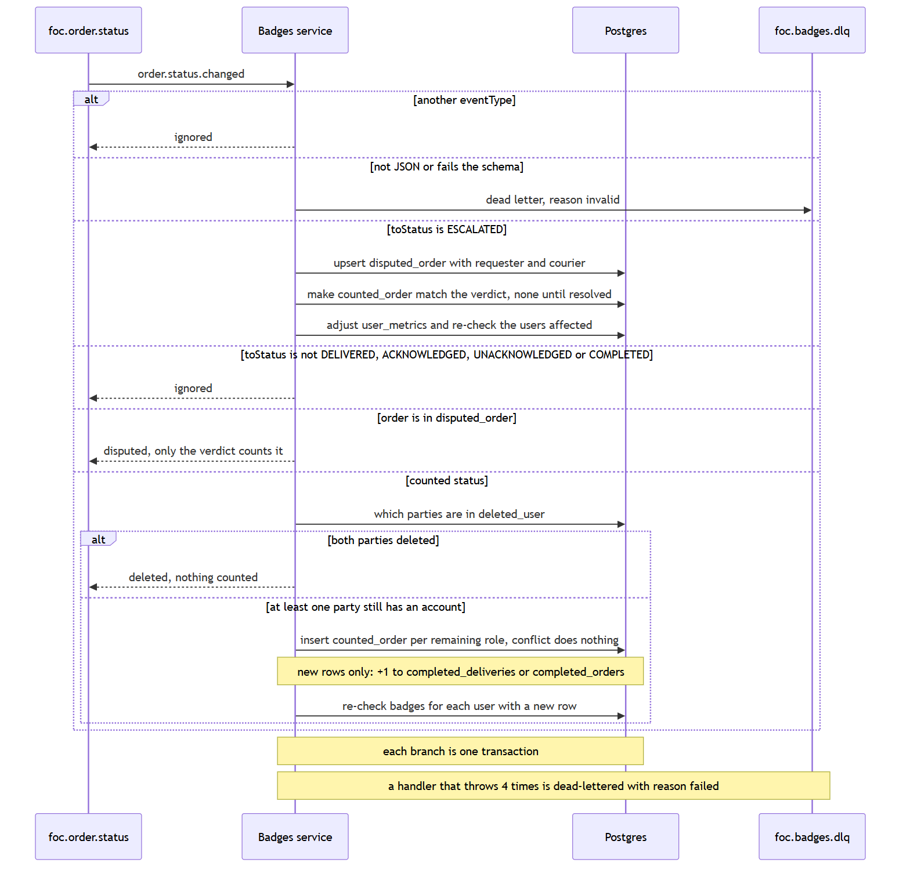
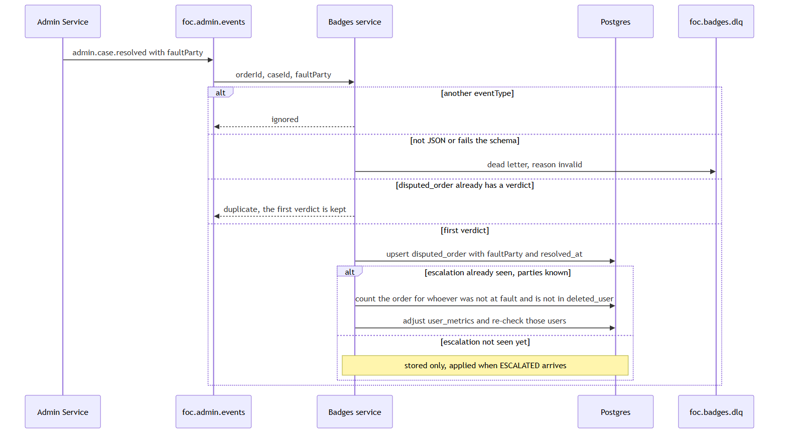
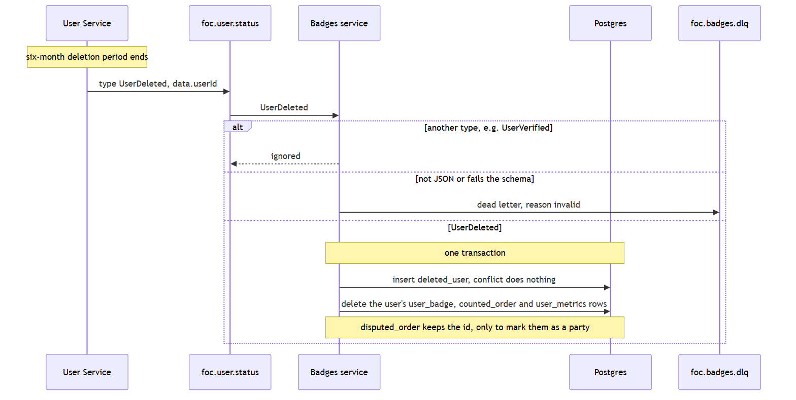
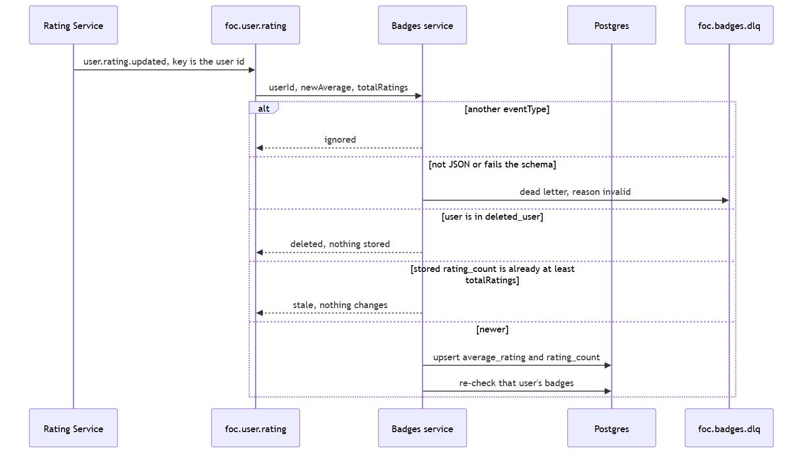
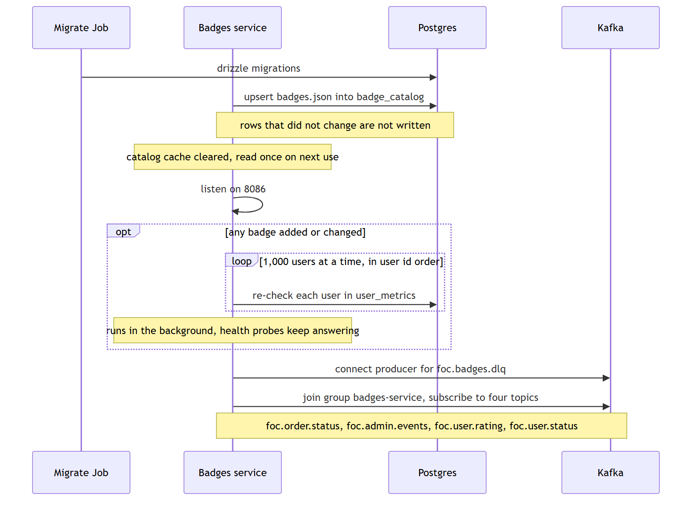
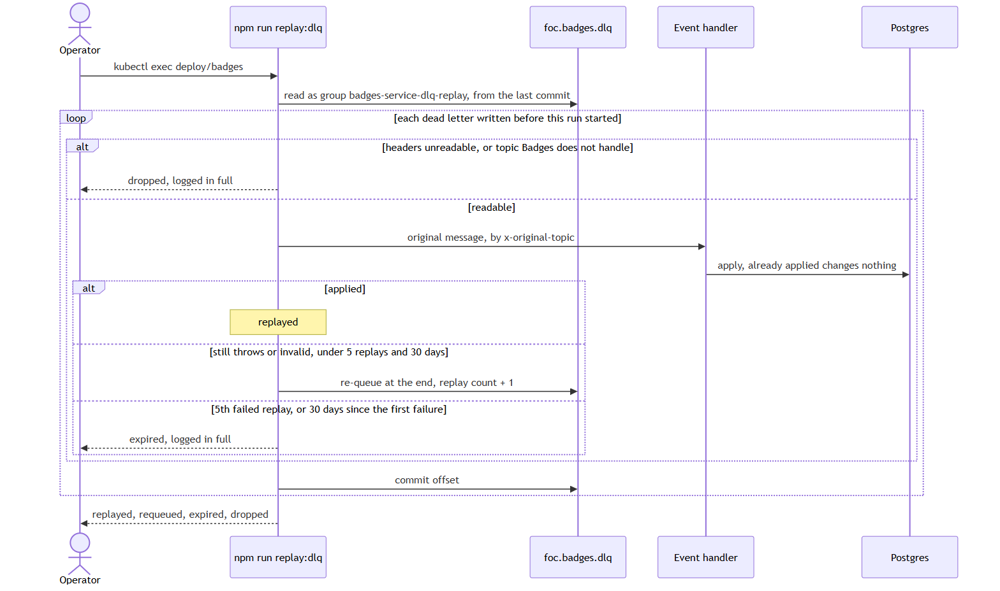

# Sequence diagrams

Each diagram is the interaction as the service implements it. Table shapes are in [schema.md](schema.md). Routes, headers, and event fields are in [interfaces.md](interfaces.md). The Mermaid source for each picture is the `.mmd` file of the same name.

Badges learns about activity from Kafka events only. It calls no other service and runs no scheduled job. The only thing it publishes is dead letters to its own topic, `foc.badges.dlq`, so it has no outbox. Each consumed event is handled in one transaction: the metric change, any `counted_order` or `disputed_order` change, and the badge re-check commit together. A failure rolls all of it back and the message is retried.

## Order events

An order counts once, the first time it reaches `DELIVERED`, `ACKNOWLEDGED`, `UNACKNOWLEDGED`, or `COMPLETED`. That is the same list Order Service uses for completed deliveries. The requester row feeds `completed_orders` and the courier row feeds `completed_deliveries`. The `(order_id, role)` primary key makes a later counted status of the same order, and a redelivered event, a no-op.

`ESCALATED` records the order and its parties in `disputed_order`, then removes any `counted_order` rows for it and takes the counts back. Once an order is in `disputed_order`, a later counted status is ignored. Only the verdict decides who it counts for.

## Admin verdict

`admin.case.resolved` stores `faultParty` on the `disputed_order` row and counts the order again for whoever was not at fault. The first verdict for an order is kept; a later one is a duplicate. The verdict and the escalation come on different topics, so either may arrive first. A verdict that arrives first is stored with no parties, and the escalation applies it when it comes.

## How a disputed order counts

| Verdict | Counts for |
| --- | --- |
| `requester` at fault | courier only |
| `courier` at fault | requester only |
| `no-fault` | both |

An order escalated from `COLLECTED` was never counted, so escalation removes nothing. An order escalated from `DELIVERED` was already counted for both, so escalation takes both counts back until the verdict.

## Account deletion

User publishes `UserDeleted` on foc.user.status once an account's six-month deletion period ends (User F5), in its own envelope (`type`, `data.userId`). Badges removes the user's metrics, badges and counted orders in one transaction and records the ID in `deleted_user`. Every later event checks that table: an order counts only for the party who still has an account, a rating for a deleted user is ignored, and a verdict counts the order only for the other party. A repeated `UserDeleted` is a no-op, and a replay can't bring the user's badges back.

## Rating updates

`user.rating.updated` carries the user's whole current average and count, not a change. Ratings are never deleted, so a higher count is always newer. A message whose `totalRatings` is not above the stored `rating_count` is stale, whether it is a redelivery or arrived out of order, and changes nothing.

## Badge states

Every event re-checks the affected users against the whole catalog. A badge is held when all its conditions hold. Only the difference is written: newly satisfied badges are earned (or earned again after a revocation) and badges no longer satisfied are revoked. Re-checking twice changes nothing the second time. `first_earned_at` keeps the first time a badge was earned; `earned_at` is the latest.

## Reads

The profile reads stored state only, so a profile view never waits on Order or Rating. The catalog is read from the database once and cached in memory until the next seed, so neither profile reads nor events query it each time. Badges are private: anyone other than the owner gets the same 404 as a route that does not exist, so the response does not reveal whether the user exists.

## Startup and catalog changes

`src/catalog/badges.json` is upserted into `badge_catalog` before the server listens. Rows that did not change are not written, and seeding clears the in-memory catalog cache. If any badge was added or changed, every user in `user_metrics` is re-checked against the new catalog, 1,000 at a time in user id order, in the background so the health probes keep answering. A new consumer group starts from the earliest offset Kafka still retains, so activity from before Badges was first deployed is read if the topics still hold it.

## Failure handling

| Failure | Result |
| --- | --- |
| Message is not JSON, or fails the schema | Logged as invalid, sent to `foc.badges.dlq`, and skipped |
| Message has another `eventType` | Ignored, not logged as an error |
| Handler throws, e.g. the database is down | Retried up to 4 attempts, waiting 200 ms × attempt between them, then logged, sent to `foc.badges.dlq`, and skipped so the partition keeps moving. If Kafka refuses the dead letter, the message is retried instead of lost |
| No `KAFKA_BROKERS` | HTTP only. Badges never change |

## Dead letters and replay

A message the consumer gives up on goes to `foc.badges.dlq` with its origin, reason, replay count and first failure time in headers (field list in [interfaces.md](interfaces.md#kafka)). The topic keeps it 30 days. `npm run replay:dlq`, run inside the badges pod, sends each dead letter written before the run started back through the handler for its original topic. A message that still fails is re-queued at the end of the topic; after its 5th failed replay or 30 days it is expired instead, so a message that can never succeed does not circle forever. Expired and dropped messages are written in full to the replay's error output so they can be applied by hand. The script exits non-zero when anything was re-queued.

Every handler ignores what it has already applied, so events can be run through again safely. `npm run replay:dlq` replays the dead-letter topic, and a new `KAFKA_GROUP_ID` replays everything Kafka still holds; both are described in the [service README](../README.md#recovering-from-missed-or-failed-events). What a replay cannot recover (activity older than Kafka's retention, a verdict Admin failed to publish, a verdict for an escalation Badges never saw) is listed under [known limitations](../README.md#known-limitations).
