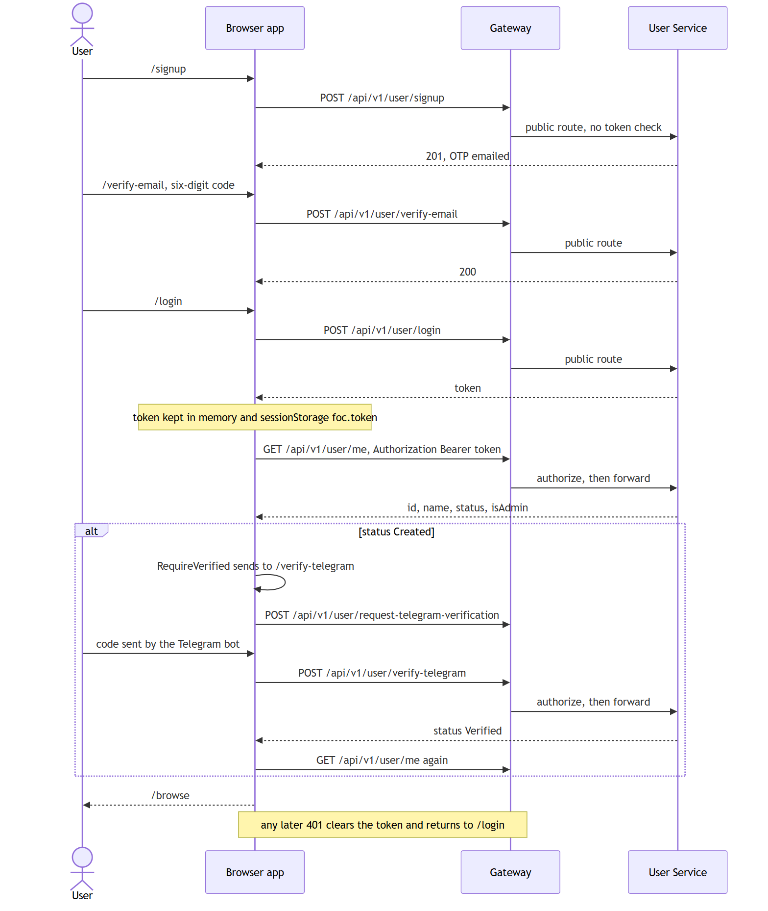
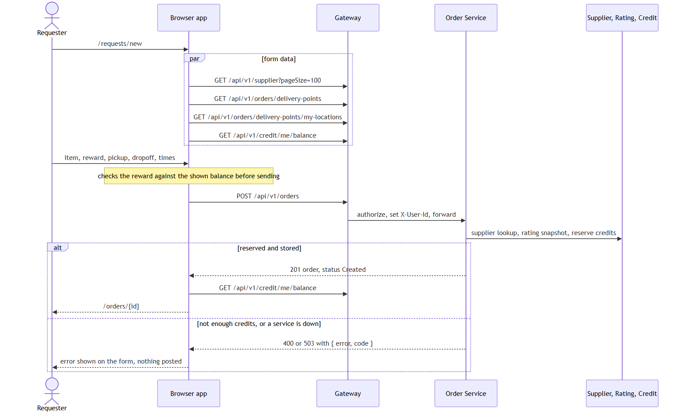
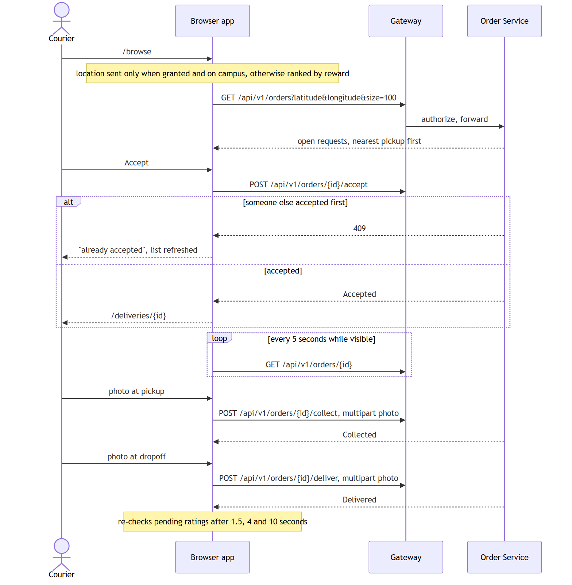
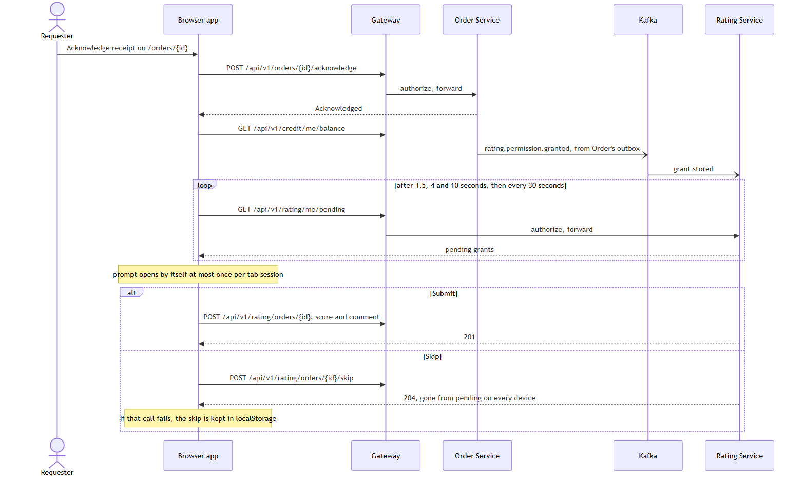
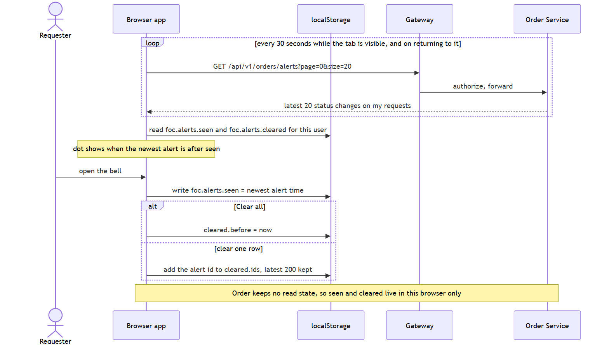

# Flows

The flows where the browser app coordinates more than one service, drawn as the code implements them. Every call, polling interval and browser storage key is listed in [interfaces.md](interfaces.md). The Mermaid source for each picture is the `.mmd` file of the same name.

The diagrams show the gateway, as in the dev environment and the local cluster. The app itself only ever calls `/api/v1/...` on its own origin; see [interfaces.md](interfaces.md#how-requests-leave-the-browser) for what answers that in each way of running it.

## Sign up and sign in

Sign-up, email verification and login are the gateway's public routes; everything after login carries the token. `GET /user/me` is the only source of who the user is: the login response's user object is not used. A `Created` account can log in but cannot use the app (it has no credits until Credit sees `UserVerified`, and Order refuses it), so `RequireVerified` holds it on the Telegram step. Any 401 later, from any service, clears the token and returns to `/login`.

## Posting a request

The form loads its choices in parallel: approved suppliers for the pickup, campus delivery points and the user's own saved places for the dropoff, and the balance. The reward is checked against the balance before sending, but the Credit Service decides: Order reserves the credits during `POST /orders`, and a failure there means no order is created. After a successful post the balance is re-read, since it has just dropped by the reward.

## Courier: accept, collect, deliver

The pool is ranked by Order: nearest pickup first when the browser sends a location, by reward otherwise. A location is sent only when the courier allows it and is on campus, since every pickup is on campus. Accepting is first come, first served; a 409 means another courier won, and the task is removed from the list. Once accepted, the task page re-reads the order every 5 seconds, so an escalation by the requester or an admin decision shows up without a reload. Collect and deliver each upload one photo as multipart form data.

## Acknowledge and rate

Acknowledging returns at once, but the permission to rate arrives at Rating over Kafka a moment later, so the app checks the pending list a few extra times right after the action and then falls back to its 30-second poll. The courier gets the same after delivering. The prompt opens by itself at most once per tab session; further pending ratings wait for the next session. Skip is recorded by the Rating Service, so the order stops being offered on every device; if that call fails, the skip is remembered in this browser instead.

## The bell

Order returns the requester's latest status changes but keeps no read state, so "seen" and "cleared" are kept in localStorage per user. The unread dot means an alert is newer than the last time the bell was opened. Clearing hides alerts in this browser only; another device still shows them.
