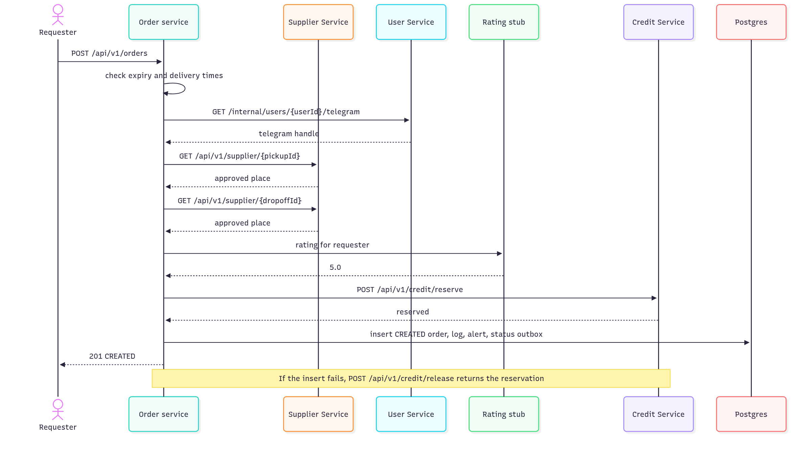
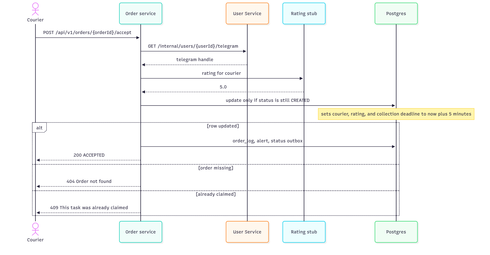
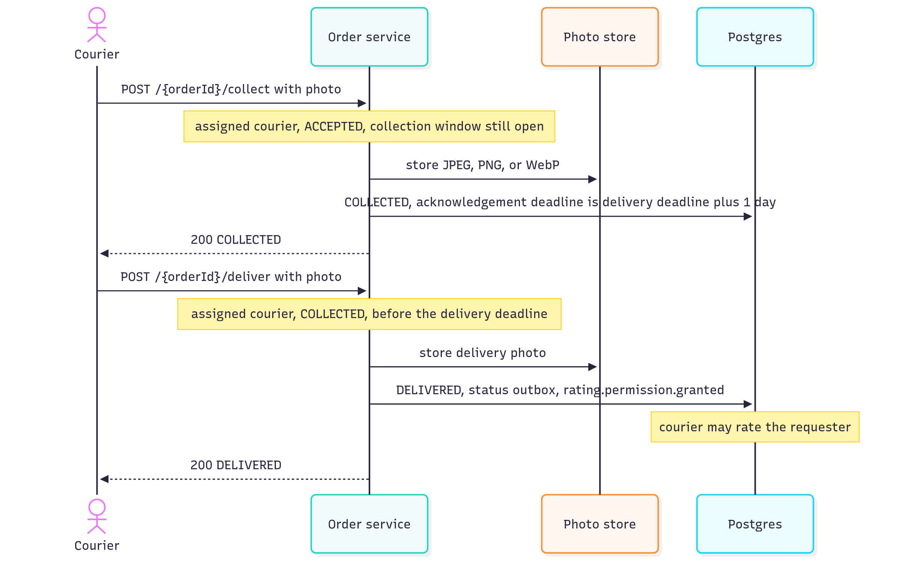
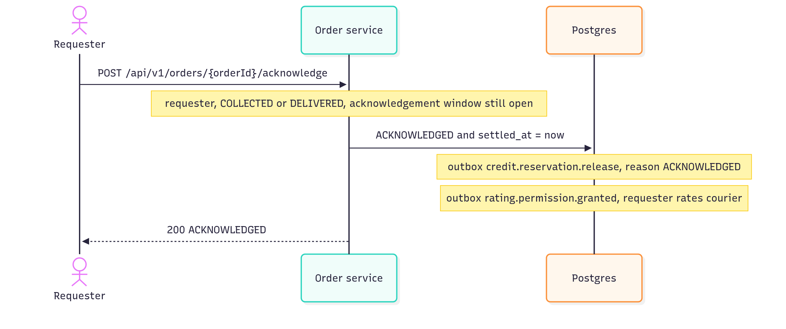
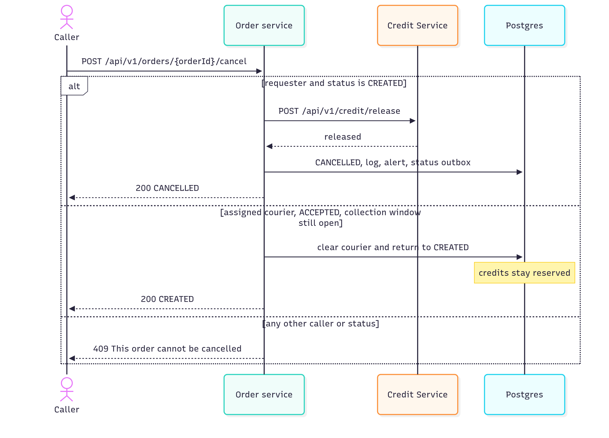
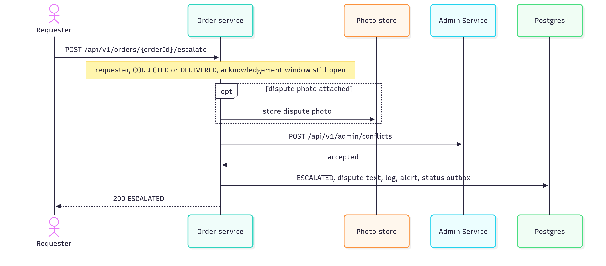
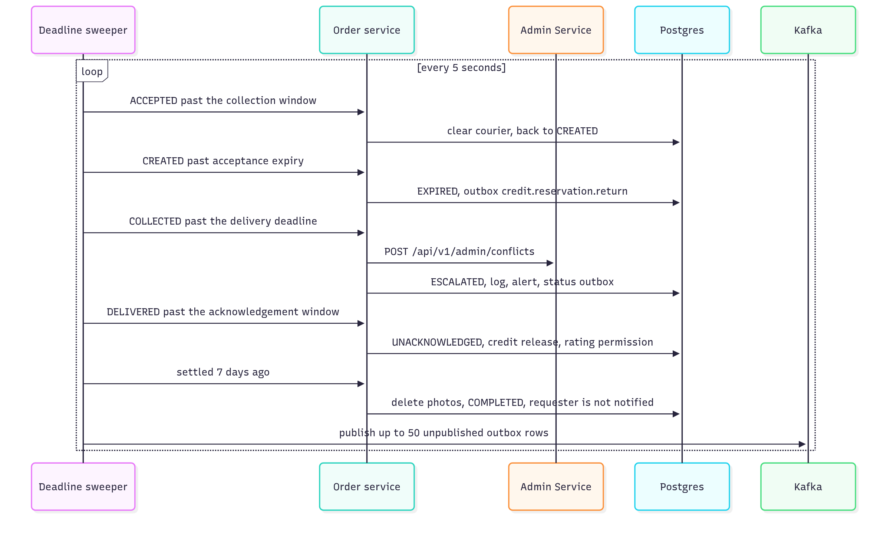
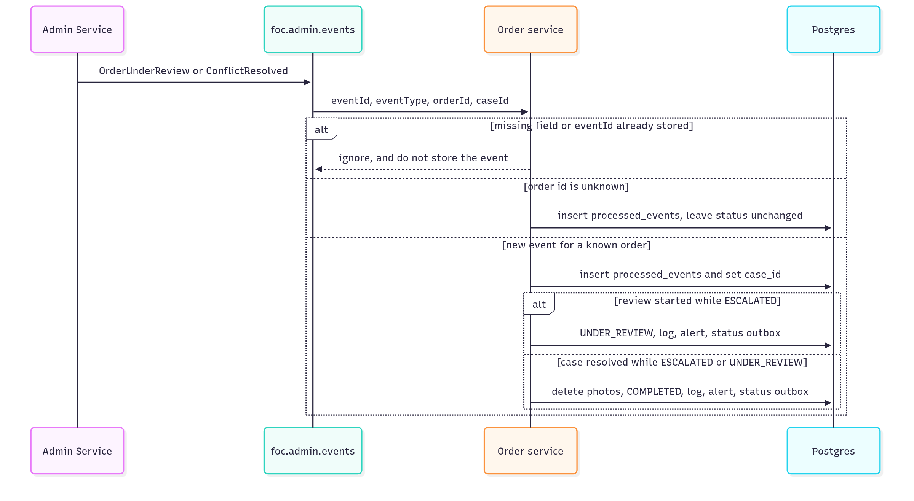
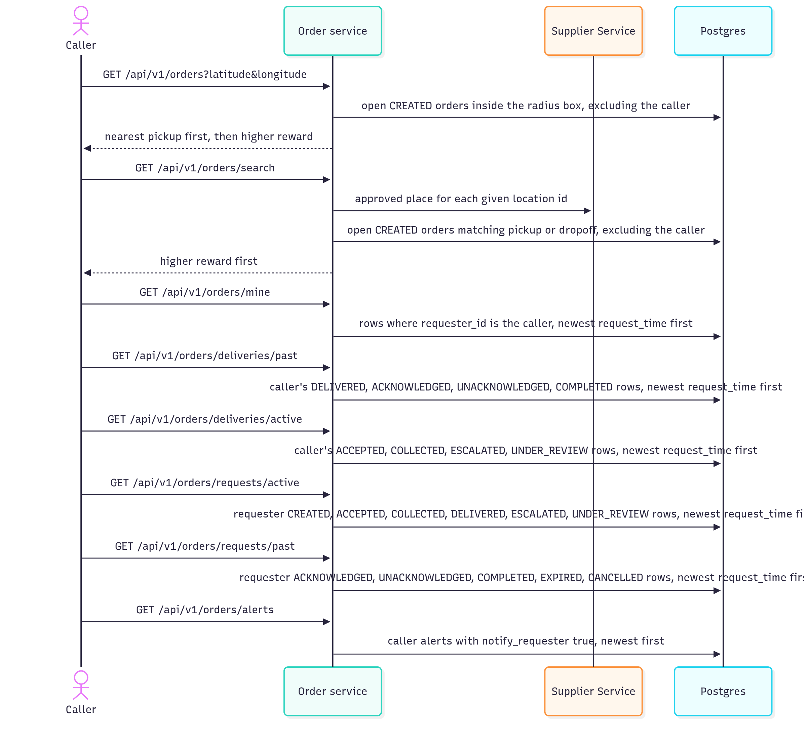
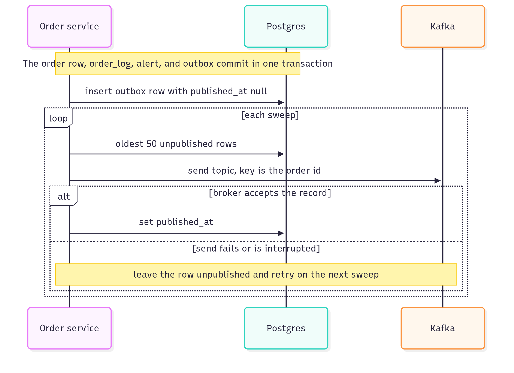

# Sequence diagrams

Each diagram is the interaction as the service implements it. The state diagram is [order-state.png](order-state.png). Table shapes are in [schema.md](schema.md). Routes, headers, and event fields are in [interfaces.md](interfaces.md).

Status changes commit the order row, `order_log`, the requester alert, and the Kafka outbox together. The broker publish happens afterward, on the sweeper. Credit reserve, credit release on requester cancel, supplier lookup, and requester escalation are synchronous and finish before that commit.

## Create

Supplier lookup and the rating snapshot happen before the credit reservation. The reservation happens before the insert. If the insert fails, the service calls credit release and then fails the request.

## Accept

Acceptance is a conditional update. Two couriers cannot both win: the second update matches zero rows and returns 409.

## Collect and deliver

The collection photo is stored before the status becomes COLLECTED. Deliver does the same for the delivery photo, then queues permission for the courier to rate the requester.

## Acknowledge

Settlement queues a credit release to the courier and permission for the requester to rate the courier. Both are outbox messages, not HTTP responses.

## Cancel and release

Only a requester cancel of a CREATED order returns credits, and that HTTP release must succeed before the row becomes CANCELLED. A courier release inside the collection window puts the order back in the pool and leaves the reservation in place.

## Requester escalation

The admin call is synchronous and is still a local stub. It must succeed before the status becomes ESCALATED. A missed delivery deadline is different: the sweeper escalates without this HTTP call and publishes `admin.escalation.opened`.

## Deadlines

Each due order is handled on its own. One failure is logged and the sweep continues. The same pass publishes the outbox.

## Admin events

`processed_events` makes a repeated `eventId` a no-op. An unknown order id is recorded and does not change a status. Review can start only from ESCALATED. Resolution from ESCALATED or UNDER_REVIEW completes the order and deletes its photos. `caseId` is stored even when the current status does not allow the transition.

## Reads

`/mine` is the requester's orders. `/deliveries/past` is the signed-in courier's delivered and later statuses. `/deliveries/active` is that courier's in-progress work, `/requests/active` is the requester's open requests, including `CREATED`, and `/requests/past` is the requester's settled requests. Those four lists are newest `requestTime` first and use the same `page` and `size` rules as `/mine`. None of them is ranked by distance.

## Outbox publish

