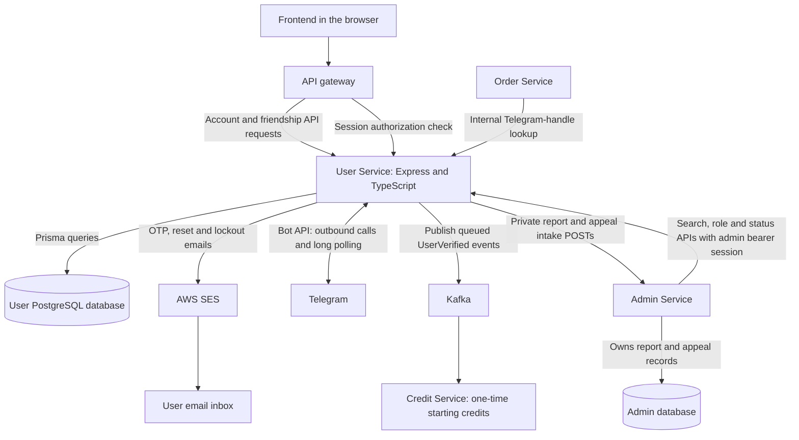
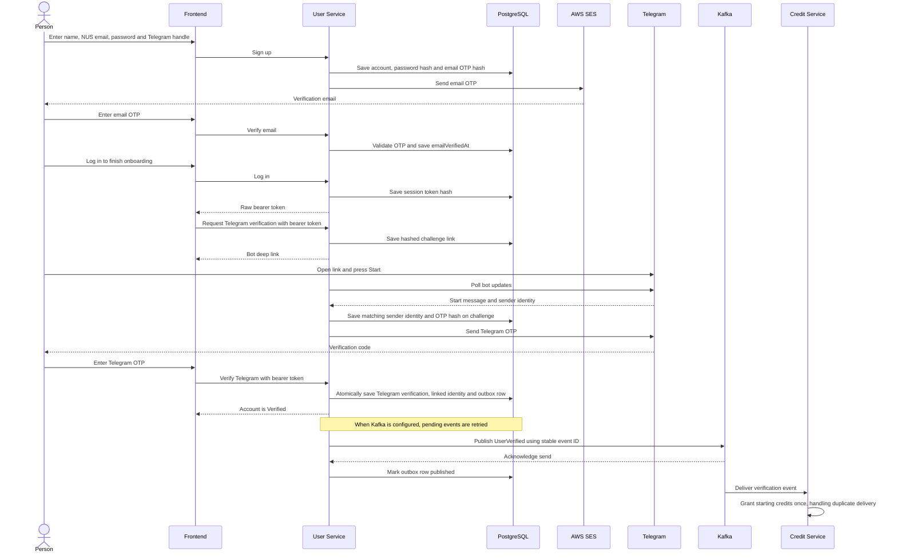

# User Service architecture

User Service owns account data and account-related decisions for Friends on Campus. This document describes the implementation in this checkout. It is not evidence that a particular cloud environment is running the same version or enforcing its policies.

For setup, environment variables, commands and integration acceptance checks, see the [README](../README.md). For tables and fields, see the [database schema guide](schema.md). HTTP operations are defined in [OpenAPI](../src/openapi.ts), available at `/api-docs` when the service is running.

## Service boundaries

- **User Service** validates input, checks credentials and permissions, and changes account records. Prisma is its database-access library, not a separate service or database.
- **PostgreSQL** stores accounts, sessions, verification records, friendship requests/history and the verification-event outbox. Other services should use User APIs or agreed events, not access these tables directly.
- **SES** delivers account emails. It does not own our user accounts, passwords or verification decisions.
- **Telegram** delivers verification messages through our bot. The bot code is inside User Service, not a separate container in the local Compose setup. Direct contact links open Telegram; User Service does not host or store chat messages.
- **Kafka** carries the verification event asynchronously. Credit Service owns balances and the starting-credit grant; User Service does not write Credit's database.
- **Order and Admin** consume User APIs. User also submits validated reports and suspension appeals to Admin, which owns their records, queues and review decisions in its own database. These arrows describe integration interfaces, not proof that every client or deployed policy has passed end-to-end testing.

## Authentication and internal access

A successful login returns an opaque, randomly generated bearer token, **not a JWT**. The client keeps the raw token; User stores only its SHA-256 hash in `AuthSession`. A bearer token is a credential: do not put it in logs, screenshots or documentation examples with real values.

For protected gateway requests, the gateway calls `/api/v1/user/internal/authorize` with the client's bearer token. User checks the session and returns identity/permission headers: `x-user-id`, `x-is-admin` and `x-permitted-action`. The gateway must remove client-supplied copies before injecting trusted values. Each receiving service still has to enforce its own permissions. An authenticated but incompletely verified user receives `x-permitted-action: false`; endpoints requiring only authentication, including friendships, do not additionally require this flag to be true.

These integration interfaces have different authentication boundaries:

| Interface | Required protection |
| --- | --- |
| Gateway authorization check | The user's bearer session; the route is not publicly exposed. |
| Order's Telegram-handle lookup | Private networking and the deployed Order-only Linkerd route policy. There is no application shared-token check. |
| User-side Admin search/role/status operations | A real eligible administrator's bearer session, forwarded by Admin Service. Being inside the cluster is not sufficient. |
| Friendship operations | A real user's bearer session and an active account with no deletion requested/scheduled. No additional verification or Order participation requirement. |
| User report submission | Real bearer session; active reporter with neither deletion requested nor scheduled, with session/account rechecked before forwarding. |
| Suspension appeal submission | Public email/password check; only a correctly authenticated suspended, unlocked account before its deletion deadline can proceed. No session is issued. |
| User-to-Admin report/appeal intake | Private, route-specific caller access required. Admin currently trusts User's validation and does not authenticate intake at application level. |

The public gateway must block `/api/v1/user/internal`. Linkerd mTLS identifies/encrypts service calls, but route authorization is also required to restrict callers. Without the mesh, any caller able to reach the Telegram lookup can use it. Local loopback binding is a development precaution, not a substitute for authentication or network policy. See the README for rollout and allow/deny acceptance tests.

The merged Order client has removed its outgoing lookup token and application token settings. Admin's merged user router forwards the administrator's `Authorization` header for search and role/status operations and handles downstream non-200 responses. Obsolete lookup-secret references remain in deployment values and Terraform; these need infrastructure cleanup. These source changes do not prove deployed caller access or successful end-to-end integration.

## Signup and verification flow

The following is the normal successful path with real email and bot providers configured. Email and Telegram verification can happen in either order. Frontend-to-User arrows represent logical API calls; the gateway is omitted here for readability.

Becoming verified does not mean credits have already arrived. They are updated by a different service after event delivery. If Kafka is unavailable or disabled, the account can still be verified while its outbox row remains pending.

In development, provider loggers can replace email/bot delivery; these are not production verification channels. Email delivery failure can leave a saved, unverified signup account: use the resend flow after resolving delivery. The non-production admin verification override is a separately gated load-test tool, not part of normal onboarding.

## Friendship lifecycle and access

The `/api/v1/user/friends` router provides send, incoming/outgoing pending-request discovery, recipient-only accept/reject, accepted-friend listing and removal. The [README](../README.md#friendships) and [contract edit guide](../API_CONTRACT_UPDATES.txt) define exact paths and responses. The new `GET /friends/requests` operation lets recipients discover request IDs. Accept/reject use that request UUID; removal instead takes the other user's UUID. Every operation validates the actual bearer session rather than trusting caller-supplied identity headers.

A `Friendship` row starts `PENDING` and may become `ACCEPTED` or `REJECTED`; removal changes `ACCEPTED` to `REMOVED`. Rejected/removed history is retained, and resending creates a new UUID. Actions on an old request cannot act on a later invitation. Repeating the same accept/reject action while its resulting state remains current returns `changed: false`; incompatible states return `409`. Removal is idempotent and does not cancel pending requests. Only the recipient may accept/reject; other callers receive `404` to avoid disclosing a private request.

Mutations lock participant accounts in a consistent UUID order and recheck the caller's current session/account inside the transaction. These account locks coordinate with suspension/deletion. A SQL partial unique index separately guarantees at most one `PENDING` or `ACCEPTED` row per unordered participant pair, including crossed/concurrent requests. Crossed requests return a conflict instead of auto-accepting. A database CHECK rejects self-relations. These custom constraints are in [migration 20261027000000_friendships](../prisma/migrations/20261027000000_friendships/migration.sql), beyond what Prisma 5 expresses in `schema.prisma`.

Suspended peers and peers with deletion requested/scheduled are excluded from both paginated lists and cannot receive new invitations. Accepting also requires the sender to remain available, including retries. An available caller may reject an existing invitation from an unavailable sender or remove an accepted relationship with an unavailable peer. Neither completed verifications nor an Order participation lookup is required. Responses expose only user IDs/names and necessary request metadata, with `Cache-Control: no-store`; no passwords, emails, Telegram details or roles are returned.

Lists order by creation time descending and request UUID ascending. Each list reads its matching count and page in a repeatable-read transaction, returning `items`, `page`, `pageSize` and `total`. Defaults are page `1` and page size `20`, with a maximum page size of `100`. Physical deletion of either participant cascades all their friendship rows; scheduling deletion only changes availability until cleanup removes the account.

The migration must be applied to the intended database before the updated service runs; `db push` alone cannot install its custom SQL constraints. Reported validation on 27 October 2026 passed Prisma Client generation, `prisma validate`, the TypeScript build, 74/74 unit tests and the friendship integration script's `node --check`. All six isolated integration suites passed after the new migration/code: friendships, email, lifecycle, admin-bootstrap, admin-users and lockout. The friendship suite applied migrations to real local PostgreSQL in a disposable `user_friendships_it_<random>` database. It exercised all six HTTP endpoints, access/privacy rules, idempotency/re-invitation, concurrency, direct SQL constraints, session rechecks, pagination and cascades. All temporary test databases were cleaned up by their scripts. Only the Compose database service was started; the friendship suite used its own ephemeral HTTP server. No normal database was migrated or normal account mutated, no real messages were sent, and the application container and Telegram poller were not started. Live/frontend, deployed, load and cross-service end-to-end acceptance remain unproven.

## Reports, suspension appeals and login

User's `POST /api/v1/user/reports` derives the reporter from a real session, validates `{ reportedUserId, comment }`, rejects self-reporting and requires an existing target before its deletion deadline. Suspended targets and targets awaiting future deletion remain reportable. Comment/message text is trimmed to 1–4000 characters. User's public `POST /api/v1/user/appeals` accepts `{ email, password, message }`, normalizes email and trims/verifies the password as login does. Unknown/wrong/locked/deletion-expired credentials receive generic `401 INVALID_CREDENTIALS`; correct credentials for an active account receive `409 ACCOUNT_NOT_SUSPENDED`. The account is rechecked under a lock before forwarding, and no account lock is held over HTTP.

Login returns `403 ACCOUNT_SUSPENDED` after a correct password for a suspended account before its deletion deadline, even when `lockedAt` is set: suspension precedes lockout. No session is issued and the lock is not cleared. Unknown accounts, wrong passwords, active locked accounts and expired deletion retain generic `401`. Appeals still reject locked accounts with generic `401`; password reset must clear the lock first. This is the explicitly approved exception to the backlog's generic-error rule. Appeals issue no session and do not reinstate or cancel deletion. Existing suspension/reinstatement operations are unchanged. Generic `/me/escalate` and Created-account verification help still need an agreed API.

User forwards camelCase `{ reporterUserId, reportedUserId, comment }` or `{ userId, message }` to Admin's respective `POST /api/v1/admin/reports` and `/api/v1/admin/appeals`. Passwords/tokens are never forwarded. A strictly validated, UUID-matched, allowlisted camelCase Admin record is returned with `201` and `Cache-Control: no-store`, with no legacy snake_case fallback; exact DTOs and errors are in the README. The required `closedAt` and `closedByAdminId` fields may be `null`. Request payloads are unchanged. Admin retains the original text when returning an existing open report for a reporter/target pair or an existing open appeal for a user. Deduplication applies while open, not for the user's lifetime. Submission itself performs no suspension/reinstatement. User's eight tables and schema diagram remain unchanged: report/appeal storage belongs to Admin, with no new User migration or outbox.

The Admin client defaults to a 5-second timeout (configurable up to 30 seconds), rejects redirects, bounds responses to 32 KiB and does not retry automatically. An empty `ADMIN_SERVICE_BASE_URL` leaves other account APIs usable but makes eligible intake return `503 ADMIN_NOT_CONFIGURED`. A configured value must be an HTTP(S) origin without credentials, path beyond `/`, query or fragment. Network errors, timeouts and upstream `429`/`5xx` become sanitized `503`; rejected/invalid responses become `502`, and upstream conflicts become `409 ADMIN_CONFLICT`. Raw errors and payloads are not logged or returned.

Appeals use a bounded process-local limiter keyed by normalized email hash: 10 attempts per 15 minutes, including unknown emails, at most 10,000 entries, returning `429` at the attempt/capacity limit. Restart resets it and replicas do not share it. Ingress throttling remains required. This guard is not a durable or distributed attempt counter.

Deployment handoff remains outstanding: allow the exact public User appeal POST without bearer preauthorization, retain bearer protection for User reports, configure `ADMIN_SERVICE_BASE_URL=http://admin:8084`, and permit User-to-Admin traffic only to intake POSTs. Current Admin mesh callers allow gateway/order and deny User. Block external Admin intake POSTs, including FastAPI trailing-slash redirect variants, while preserving authenticated Admin GET queues/detail and review routes. Admin intake trusts User and must not be publicly reachable as a bypass. Frontend report/appeal forms, login `403` handling and friendship UI belong to their owner. This User Service PR makes no infrastructure, Admin or frontend edits.

The global error handler adds `Cache-Control: no-store`, maps malformed/oversized JSON to `400 INVALID_JSON` / `413 REQUEST_TOO_LARGE` (32 KiB request limit), and avoids logging raw parser/database errors. Unexpected `500` failures log only a constant message, protecting credentials and request bodies.

Historical checks before the camelCase response fix, reported on 30 October 2026, passed: TypeScript build, Prisma generation/validation, 83/83 unit tests, all seven isolated integration suites (email, lifecycle, admin-bootstrap, admin-users, lockout, friendships and account-support), strict new-unit-test type checking and integration-script syntax checks. All temporary databases were cleaned up. Support integration used real User HTTP/PostgreSQL with an HTTP Admin stub, not the actual Admin application or database. The Node 20 production Docker build and network-isolated smoke test passed (Node 20.20.2, non-root, 256 MiB, no `.env`, health/OpenAPI checks; no database or real Admin exercised). The 183-package install audit and Docker `npm ci` reported zero vulnerabilities. No normal database was migrated, no real email/bot messages were sent and no cloud deployment occurred. Actual Admin, cloud/frontend, gateway/mesh, load and full cross-service acceptance remain unproven; infrastructure changes are handoff only.

## Why these choices?

| Choice | Reason and trade-off |
| --- | --- |
| Express and TypeScript | Explicit HTTP handlers with types for application code. Runtime validation is still needed for untrusted inputs. |
| PostgreSQL and Prisma | Relational constraints and transactions fit linked account/security records. Prisma provides typed database access and versioned migrations; it does not replace database backups or operational management. |
| Salted scrypt password hashes | Passwords can be checked without storing recoverable plaintext. The encoded value includes its random salt and cost so future logins can verify it. |
| Database-backed opaque sessions | Sessions can be revoked and current account data checked without relying on old claims embedded in a token. This requires database work during authentication. |
| Separate short-lived OTP/reset/session records | Supports expiry, attempts, single use and revocation without putting every temporary credential on the account row. Only hashes are stored. |
| Transactional verification outbox | Verification and the intention to publish commit together. Retries may deliver duplicates, so Credit must remain idempotent. This is not exactly-once delivery. |
| Row/advisory locks for sensitive mutations | Coordinate concurrent verification, failed logins, admin changes and last-admin checks. Locking details belong in the implementation and tests. |
| Friendship history plus an active-pair partial unique index | Fresh request UUIDs preserve invitation identity after rejection/removal; the unordered-pair SQL constraint prevents duplicate active relations across both directions. |
| Telegram long polling | The service fetches bot updates with outbound requests, so no public webhook is needed. Only one active poller may use a bot token; replicas/environments need coordinated configuration. |
| Operator-only first-admin command | Resolves initial admin setup without exposing an open promotion endpoint. It promotes an existing fully verified eligible account and records an audit entry. |

## Containers, databases and configuration

Locally, [Docker Compose](../docker-compose.yml) runs **two containers** for this service: the Node application and PostgreSQL. The database uses a named Docker volume so ordinary container replacement does not erase its data. Removing the volume can erase it; a volume is not a backup.

| Connection | Local address |
| --- | --- |
| Browser or host tools to User API | `http://localhost:8080` (Compose binds the API to `127.0.0.1`) |
| Host database tools to PostgreSQL | `localhost:5554` |
| Application container to PostgreSQL | `db:5432` on the Compose network |

`localhost` inside a container means that container, not the host or another container. A port selects the listening application at an address; it is not the database itself. The database host-port publication is development-only and should not be exposed on an untrusted network.

The [Dockerfile](../Dockerfile) builds TypeScript into JavaScript and supplies separate migration and runtime stages. The production runtime runs compiled JavaScript as a non-root user; local Compose selects the build stage and runs the development server plus migrations.

For deployment, the application and database remain separate. `DATABASE_URL` chooses the target PostgreSQL database, which may run outside the application container. Database provisioning, network access, migrations, backups and credentials must also be configured; changing the URL alone does not create or move a database. Git commits and image rebuilds do not migrate existing account data automatically.

Local `.env` values are not committed or included in the image. Deployment supplies its own environment configuration and secrets, including database access, OTP secret and Telegram credentials. SES also needs approved AWS permissions. Never copy personal credentials into these guides. Configuration being present in source does not establish that the live environment uses it.

Repository values now wire the optional `user-telegram` Secret's token/username keys, with dev mapping from Secrets Manager `foc/dev/user-telegram` and one polling replica. Terraform initializes empty placeholders. Real bot credentials, deployed configuration and delivery remain unverified; see the README's Telegram setup notes.

## Current boundaries and remaining work

Implemented areas include signup, both verifications, login/session authorization, profile/status, password recovery/change, login lockout notifications, scheduled account deletion, first-admin bootstrap, User-side Admin management APIs, friendships, user reports and suspension appeals. The [schema guide](schema.md) explains User-owned records; Admin owns report/appeal storage.

Still outstanding or requiring separate acceptance:

- Generic `/me/escalate` and Created-account verification help still need an agreed API. Reports and suspension appeals passed the recorded service checks using an HTTP Admin stub. Actual Admin integration, frontend and deployed acceptance remain unproven, as does live/frontend friendship acceptance.
- Emails are not a durable job queue. A delivery failure or process crash can lose a lockout warning; the verification outbox covers Kafka events, not email sending.
- Cross-service flows and live gateway/mesh enforcement need acceptance tests in the intended environment. Service-level tests do not prove deployed integration.
- Load acceptance is unproven: no User load suite/report was found for NFR3 (60,000 accounts, 95% of auth/lookups under 1 second) or NFR6 (100 concurrent users, 95% under 2 seconds). The verification override is test setup, not evidence that these targets pass.
- Direct Telegram contact links are not a bot-mediated chat service. Any broader chat requirement needs a separately agreed scope.

## Implementation map

| Area | Source |
| --- | --- |
| HTTP application and API operations | [app.ts](../src/app.ts), [routes](../src/routes), [openapi.ts](../src/openapi.ts) |
| Password/token helpers and sessions | [security.ts](../src/security.ts), [auth.ts](../src/auth.ts) |
| Computed status and authorization headers | [status.ts](../src/status.ts), [authorization.ts](../src/authorization.ts) |
| Email and Telegram | [email.ts](../src/email.ts), [telegram.ts](../src/telegram.ts) |
| Verification outbox and Kafka | [verification-events.ts](../src/verification-events.ts), [kafka.ts](../src/kafka.ts) |
| Login lockout and account deletion | [login-security.ts](../src/login-security.ts), [account-lifecycle.ts](../src/account-lifecycle.ts) |
| Administrator operations | [admin-users.ts](../src/admin-users.ts), [admin-bootstrap.ts](../src/admin-bootstrap.ts) |
| Friendship lifecycle and HTTP routes | [friendships.ts](../src/friendships.ts), [friendship routes](../src/routes/friendships.ts) |
| Report/appeal validation, limiter and Admin client | [account-support.ts](../src/account-support.ts), [support routes](../src/routes/account-support.ts), [admin-intake.ts](../src/admin-intake.ts) |
| Schema and database changes | [schema.prisma](../prisma/schema.prisma), [migrations](../prisma/migrations) |
