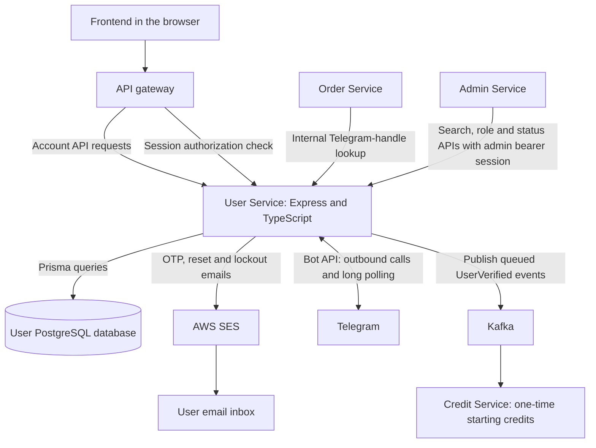
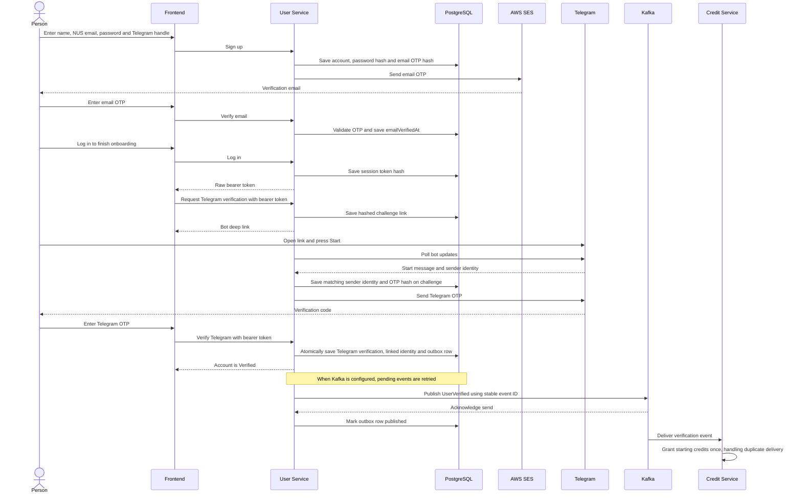

# User Service architecture

User Service owns account data and account-related decisions for Friends on Campus. This document describes the implementation in this checkout. It is not evidence that a particular cloud environment is running the same version or enforcing its policies.

For setup, environment variables, commands and integration acceptance checks, see the [README](../README.md). For tables and fields, see the [database schema guide](schema.md). HTTP operations are defined in [OpenAPI](../src/openapi.ts), available at `/api-docs` when the service is running.

## Service boundaries

- **User Service** validates input, checks credentials and permissions, and changes account records. Prisma is its database-access library, not a separate service or database.
- **PostgreSQL** stores accounts, sessions, verification records and the verification-event outbox. Other services should use User APIs or agreed events, not access these tables directly.
- **SES** delivers account emails. It does not own our user accounts, passwords or verification decisions.
- **Telegram** delivers verification messages through our bot. The bot code is inside User Service, not a separate container in the local Compose setup. Direct contact links open Telegram; User Service does not host or store chat messages.
- **Kafka** carries the verification event asynchronously. Credit Service owns balances and the starting-credit grant; User Service does not write Credit's database.
- **Order and Admin** are API consumers. Their arrows describe integration interfaces, not proof that every client or deployed policy has passed end-to-end testing.

## Authentication and internal access

A successful login returns an opaque, randomly generated bearer token, **not a JWT**. The client keeps the raw token; User stores only its SHA-256 hash in `AuthSession`. A bearer token is a credential: do not put it in logs, screenshots or documentation examples with real values.

For protected gateway requests, the gateway calls `/api/v1/user/internal/authorize` with the client's bearer token. User checks the session and returns identity/permission headers: `x-user-id`, `x-is-admin` and `x-permitted-action`. The gateway must remove client-supplied copies before injecting trusted values. Each receiving service still has to enforce its own permissions. An authenticated but incompletely verified user does not have permitted actions.

These integration interfaces have different authentication boundaries:

| Interface | Required protection |
| --- | --- |
| Gateway authorization check | The user's bearer session; the route is not publicly exposed. |
| Order's Telegram-handle lookup | Private networking and the deployed Order-only Linkerd route policy. There is no application shared-token check. |
| User-side Admin search/role/status operations | A real eligible administrator's bearer session, forwarded by Admin Service. Being inside the cluster is not sufficient. |

The public gateway must block `/api/v1/user/internal`. Linkerd mTLS identifies/encrypts service calls, but route authorization is also required to restrict callers. Without the mesh, any caller able to reach the Telegram lookup can use it. Local loopback binding is a development precaution, not a substitute for authentication or network policy. See the README for rollout and allow/deny acceptance tests.

## Signup and verification flow

The following is the normal successful path with real email and bot providers configured. Email and Telegram verification can happen in either order. Frontend-to-User arrows represent logical API calls; the gateway is omitted here for readability.

Becoming verified does not mean credits have already arrived. They are updated by a different service after event delivery. If Kafka is unavailable or disabled, the account can still be verified while its outbox row remains pending.

In development, provider loggers can replace email/bot delivery; these are not production verification channels. Email delivery failure can leave a saved, unverified signup account: use the resend flow after resolving delivery. The non-production admin verification override is a separately gated load-test tool, not part of normal onboarding.

## Why these choices?

| Choice | Reason and trade-off |
| --- | --- |
| Express and TypeScript | Explicit HTTP handlers with types for application code. Runtime validation is still needed for untrusted inputs. |
| PostgreSQL and Prisma | Relational constraints and transactions fit linked account/security records. Prisma provides typed database access and versioned migrations; it does not replace database backups or operational management. |
| Salted scrypt password hashes | Passwords can be checked without storing recoverable plaintext. The encoded value includes its random salt and cost so future logins can verify it. |
| Database-backed opaque sessions | Sessions can be revoked and current account data checked without relying on old claims embedded in a token. This requires database work during authentication. |
| Separate short-lived OTP/reset/session records | Supports expiry, attempts, single use and revocation without putting every temporary credential on the account row. Only hashes are stored. |
| Transactional verification outbox | Verification and the intention to publish commit together. Retries may deliver duplicates, so Credit must remain idempotent. This is not exactly-once delivery. |
| Row/advisory locks for sensitive mutations | Coordinate concurrent verification, failed logins, admin changes and last-admin checks. Locking details belong in the implementation and tests. |
| Telegram long polling | The service fetches bot updates with outbound requests, so no public webhook is needed. Only one active poller may use a bot token; replicas/environments need coordinated configuration. |
| Operator-only first-admin command | Resolves initial admin setup without exposing an open promotion endpoint. It promotes an existing fully verified eligible account and records an audit entry. |

## Containers, databases and configuration

Locally, [Docker Compose](../docker-compose.yml) runs **two containers** for this service: the Node application and PostgreSQL. The database uses a named Docker volume so ordinary container replacement does not erase its data. Removing the volume can erase it; a volume is not a backup.

| Connection | Local address |
| --- | --- |
| Browser or host tools to User API | `http://localhost:8080` (Compose binds the API to `127.0.0.1`) |
| Host database tools to PostgreSQL | `localhost:5554` |
| Application container to PostgreSQL | `db:5432` on the Compose network |

`localhost` inside a container means that container, not the host or another container. A port selects the listening application at an address; it is not the database itself. The database host-port publication is development-only and should not be exposed on an untrusted network.

The [Dockerfile](../Dockerfile) builds TypeScript into JavaScript and supplies separate migration and runtime stages. The production runtime runs compiled JavaScript as a non-root user; local Compose selects the build stage and runs the development server plus migrations.

For deployment, the application and database remain separate. `DATABASE_URL` chooses the target PostgreSQL database, which may run outside the application container. Database provisioning, network access, migrations, backups and credentials must also be configured; changing the URL alone does not create or move a database. Git commits and image rebuilds do not migrate existing account data automatically.

Local `.env` values are not committed or included in the image. Deployment supplies its own environment configuration and secrets, including database access, OTP secret and Telegram credentials. SES also needs approved AWS permissions. Never copy personal credentials into these guides. Configuration being present in source does not establish that the live environment uses it.

## Current boundaries and remaining work

Implemented areas include signup, both verifications, login/session authorization, profile/status, password recovery/change, login lockout notifications, scheduled account deletion, first-admin bootstrap and User-side Admin management APIs. The [schema guide](schema.md) explains their stored records.

Still outstanding or requiring separate acceptance:

- Friendship management and account escalation to Admin are not implemented; no corresponding tables are present.
- Emails are not a durable job queue. A delivery failure or process crash can lose a lockout warning; the verification outbox covers Kafka events, not email sending.
- Cross-service flows and live gateway/mesh enforcement need acceptance tests in the intended environment. Service-level tests do not prove deployed integration.
- Direct Telegram contact links are not a bot-mediated chat service. Any broader chat requirement needs a separately agreed scope.

## Implementation map

| Area | Source |
| --- | --- |
| HTTP application and API operations | [app.ts](../src/app.ts), [routes](../src/routes), [openapi.ts](../src/openapi.ts) |
| Password/token helpers and sessions | [security.ts](../src/security.ts), [auth.ts](../src/auth.ts) |
| Computed status and authorization headers | [status.ts](../src/status.ts), [authorization.ts](../src/authorization.ts) |
| Email and Telegram | [email.ts](../src/email.ts), [telegram.ts](../src/telegram.ts) |
| Verification outbox and Kafka | [verification-events.ts](../src/verification-events.ts), [kafka.ts](../src/kafka.ts) |
| Login lockout and account deletion | [login-security.ts](../src/login-security.ts), [account-lifecycle.ts](../src/account-lifecycle.ts) |
| Administrator operations | [admin-users.ts](../src/admin-users.ts), [admin-bootstrap.ts](../src/admin-bootstrap.ts) |
| Schema and database changes | [schema.prisma](../prisma/schema.prisma), [migrations](../prisma/migrations) |
