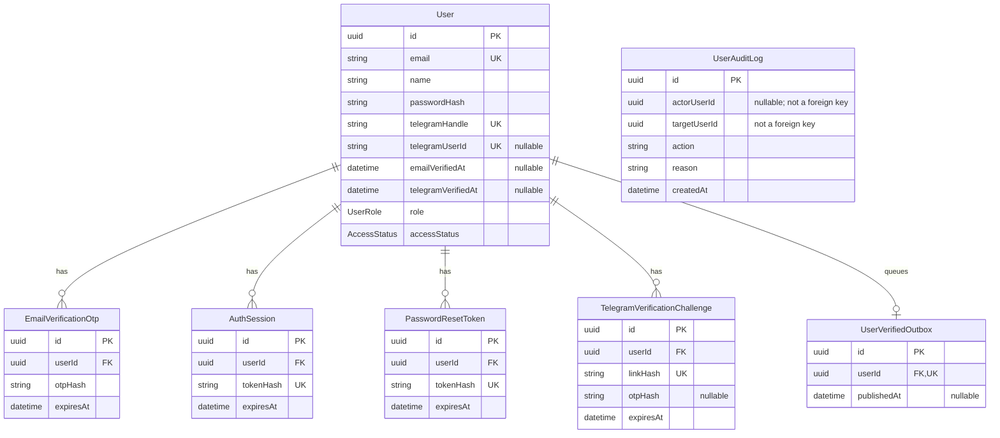

# User Service database schema

A **schema** is the database blueprint: the tables, their columns, allowed values and relationships. A table is like a spreadsheet; a row is one record and a column is one field.

We already have an executable schema in [prisma/schema.prisma](../prisma/schema.prisma). This guide explains it; it does not introduce another schema or change the database. [Prisma migrations](../prisma/migrations) record the SQL changes applied to existing databases. See the [architecture guide](architecture.md) for how the database fits into the service.

## Table relationships

All seven tables belong to the User Service PostgreSQL database. They are not separate databases or containers. The diagram shows selected columns; the tables below explain every stored field.

- **PK (primary key):** uniquely identifies a row. Every table uses an application-generated UUID `id`.
- **FK (foreign key):** a database-enforced reference to another row. The five child tables above use `userId` to reference `User.id`.
- **UK (unique key):** prevents duplicate values. Nullable unique fields allow multiple rows with no value, but not duplicate non-null values.
- **Nullable:** the field can be empty (`null`), usually meaning an action has not happened yet.
- **One-to-many:** one user may have zero or many OTPs, sessions, reset tokens and Telegram challenges. Each child belongs to exactly one user.
- **One-to-zero-or-one:** one user may have at most one verification-outbox row, enforced by its unique `userId`.

`UserAuditLog` intentionally has no relationship line: its UUID references are **not foreign keys**. This lets the minimal audit record survive account removal. UUIDs still identify records and should be treated as sensitive, not as anonymous data.

## Common types and conventions

Prisma `String @db.Uuid` is a PostgreSQL UUID; ordinary `String` fields are text. `DateTime` records timestamps and `Int` stores whole numbers. See the schema and migration SQL for exact database types and defaults.

Every table has `id` (UUID, primary key, generated with `uuid()`) and `createdAt` (timestamp, defaults to creation time). Each table section below lists its remaining stored fields. Prisma relation properties such as `User.sessions` are navigation helpers, not extra columns storing copies of child rows.

### User: the account

| Field | Meaning / rule |
| --- | --- |
| `email` | Required unique normalized email. Signup accepts configured NUS domains. |
| `name` | Required display name. The API trims it and enforces 2-100 characters; it is not derived from the email prefix. |
| `passwordHash` | Required encoded scrypt value containing algorithm, cost, random salt and derived hash. Not a recoverable encrypted password. |
| `telegramHandle` | Required unique normalized username, without the leading `@`. |
| `emailVerifiedAt` | Nullable timestamp; set after successful email verification. |
| `telegramVerifiedAt` | Nullable timestamp; set after successful Telegram verification. |
| `telegramUserId` | Nullable unique Telegram account ID, stored as text. Linked during real bot verification; distinct from the username. |
| `role` | `USER` or `ADMIN`; defaults to `USER`. |
| `accessStatus` | `ACTIVE` or `SUSPENDED`; defaults to `ACTIVE`. This is not the public Created/Verified/Suspended status. |
| `failedLoginAttempts` | Required counter, defaults to `0`; used for login lockout. |
| `lockedAt` | Nullable timestamp indicating login lockout; password reset clears it. |
| `lastLoginAt` | Nullable timestamp of the most recent successful login. |
| `deletionRequestedAt` | Nullable timestamp of a deletion request. |
| `scheduledDeletionAt` | Nullable removal deadline, normally six calendar months after the request. |
| `suspendedAt` | Nullable suspension timestamp. |
| `suspensionReason` | Nullable stored suspension reason. |
| `authVersion` | Integer starting at `0`, incremented by credential/administrative changes. It is not a JWT version claim or the sole revocation mechanism; sessions are explicitly revoked too. |
| `updatedAt` | Timestamp maintained by Prisma on account updates. |

The name/email/handle rules are application validation; the schema does not impose a 100-character database limit on `name` or a database email-domain check. Required/unique fields, UUID types, enums and foreign keys are database constraints.

### EmailVerificationOtp: email verification attempts

| Field | Meaning / rule |
| --- | --- |
| `userId` | Required FK to the account. |
| `otpHash` | Required HMAC-SHA-256 digest bound to the normalized email and server OTP secret; not the six-digit code itself. |
| `expiresAt` | Required expiry timestamp. |
| `attemptCount` | Failed-attempt counter, defaults to `0`. |
| `usedAt` | Nullable timestamp marking a consumed code. |
| `revokedAt` | Nullable timestamp marking an invalidated code. |

Historical rows can remain after use, expiry or revocation. The verification handler selects/checks eligible records; row existence does not mean a code is valid.

### AuthSession: successful logins

| Field | Meaning / rule |
| --- | --- |
| `userId` | Required FK to the account. |
| `tokenHash` | Required unique SHA-256 hash of a random bearer token; not the raw client token. |
| `expiresAt` | Required session expiry. |
| `revokedAt` | Nullable timestamp; set to invalidate a session before expiry. |
| `lastUsedAt` | Nullable timestamp updated during authentication. |

One account can have multiple sessions, such as separate browser logins. Authentication also checks current account restrictions; a stored row is not proof of usable access.

### PasswordResetToken: password-recovery links

| Field | Meaning / rule |
| --- | --- |
| `userId` | Required FK to the account. |
| `tokenHash` | Required unique SHA-256 hash of the random token in the reset link. |
| `expiresAt` | Required expiry timestamp. |
| `usedAt` | Nullable timestamp; a successful reset consumes the token. |
| `revokedAt` | Nullable timestamp; invalidates replaced or cancelled links. |

The raw reset token is delivered in the link, not stored in this table. A successful reset changes the password, clears login lockout and revokes existing sessions.

### TelegramVerificationChallenge: linking and verifying Telegram

| Field | Meaning / rule |
| --- | --- |
| `userId` | Required FK to the account. |
| `linkHash` | Required unique hash of the random token in the bot deep link. |
| `otpHash` | Nullable HMAC digest; set when an OTP is prepared for the matching Telegram sender. |
| `telegramUserId` | Nullable Telegram sender ID, stored as text. The unique linked-account constraint is on `User.telegramUserId`, not this history field. |
| `expiresAt` | Required challenge/code expiry. |
| `sentAt` | Nullable timestamp recording OTP sending. |
| `attemptCount` | Failed-attempt counter, defaults to `0`. |
| `usedAt` | Nullable timestamp marking successful consumption. |
| `revokedAt` | Nullable timestamp invalidating the challenge. |

The bot checks the sender against the registered handle. The user then submits the OTP through the authenticated application. Merely pressing Start does not finish verification. The local development logger is a separate testing path, not proof of real Telegram ownership.

### UserVerifiedOutbox: reliable intention to publish verification

| Field | Meaning / rule |
| --- | --- |
| `userId` | Required unique FK to the account: at most one outbox record per user. |
| `email` | Required email snapshot included in the verification event. This table contains personal data. |
| `publishedAt` | Nullable timestamp. `null` means pending; otherwise Kafka acknowledged publication and the marker was saved. |

The common `id` becomes `eventId`, and `createdAt` becomes `occurredAt` in the event. They remain stable on retries. The outbox row is saved in the same transaction as completion of verification, so an event intention is not lost between those database writes.

The worker publishes to `foc.user.status` (configurable), keyed by user UUID, with `{ eventId, type: "UserVerified", occurredAt, data: { userId, email } }`. If publication succeeds but saving `publishedAt` fails, another delivery is possible. Consumers must handle duplicates. A published marker does not prove Credit has finished processing. This is an event outbox, not an email-delivery queue or the full verification history.

### UserAuditLog: minimal administrative audit trail

| Field | Meaning / rule |
| --- | --- |
| `actorUserId` | Nullable UUID of the acting administrator; not an FK. Bootstrap uses `null` because an operator runs it outside an application session. |
| `targetUserId` | Required UUID of the affected account; not an FK. |
| `action` | Required action identifier, such as `FIRST_ADMIN_BOOTSTRAPPED`. |
| `reason` | Required reason text supplied by the operation. |

The table has no dedicated email, name, Telegram or credential columns. It survives deletion and is not automatically cascaded away. Do not put personal data or secrets in free-text reasons. It is not a log of every login or every profile read, and it does not replace Admin Service's separate audit/event responsibilities.

## Status is computed, not a single stored label

The API's account status comes from [status.ts](../src/status.ts):

| Stored account fields | Public status |
| --- | --- |
| `accessStatus = SUSPENDED` | `Suspended`, regardless of verification timestamps |
| `accessStatus = ACTIVE` and both verification timestamps are set | `Verified` |
| `accessStatus = ACTIVE` and either timestamp is missing | `Created` |

`ACTIVE` therefore does **not** mean fully verified. `role = ADMIN` is a separate question from verification or suspension.

Login lockout (`lockedAt`) and pending deletion (`scheduledDeletionAt`) are also separate from this public label. A `Verified` label alone is not an access-control decision; session validity, account restrictions and operation-specific checks still apply. Reinstatement clears suspension, not missing verification or login lockout. The non-production verification override is a separately gated exception and is not a production onboarding path.

## Expiry, deletion and indexes

Each of the five FK-linked child tables uses `onDelete: Cascade`: physically deleting a `User` also deletes its OTPs, sessions, reset tokens, Telegram challenges and outbox row. Scheduling deletion is not immediate physical deletion. It revokes credentials, sets a deadline and lets the cleanup worker remove the account after that deadline. Correct-password login before the deadline can cancel the request; it does not restore old revoked sessions.

There is no automatic retention sweep for all expired OTP/session/reset/challenge rows described by this schema. Expiry makes a credential unusable through application checks; it does not by itself delete its row. Audit retention and any future cleanup policy need separate operational decisions.

Explicit non-unique indexes are:

| Table | Indexed fields |
| --- | --- |
| `User` | `accessStatus`; `scheduledDeletionAt` |
| `EmailVerificationOtp` | `(userId, createdAt)`; `expiresAt` |
| `AuthSession` | `userId`; `expiresAt` |
| `PasswordResetToken` | `userId`; `expiresAt` |
| `TelegramVerificationChallenge` | `(userId, createdAt)`; `expiresAt` |
| `UserVerifiedOutbox` | `(publishedAt, createdAt)` |
| `UserAuditLog` | `(targetUserId, createdAt)` |

An index helps PostgreSQL locate matching rows without scanning the whole table. Primary/unique constraints also create indexes. Indexes do not independently enforce code expiry or application permissions.

## Changing the schema safely

Changing documentation does not change PostgreSQL. A future structural change normally requires updating `schema.prisma`, generating/reviewing a migration, applying it to the intended database through the project's migration workflow, regenerating Prisma Client and testing the affected flows. Existing databases need migrations; rebuilding an application image alone is not enough.

Keep this guide aligned with the executable schema. Friendship and account-escalation storage are not implemented and are intentionally absent from the diagram. For setup and existing test commands, use the [README](../README.md) rather than copying credentials or duplicating command lists here.
